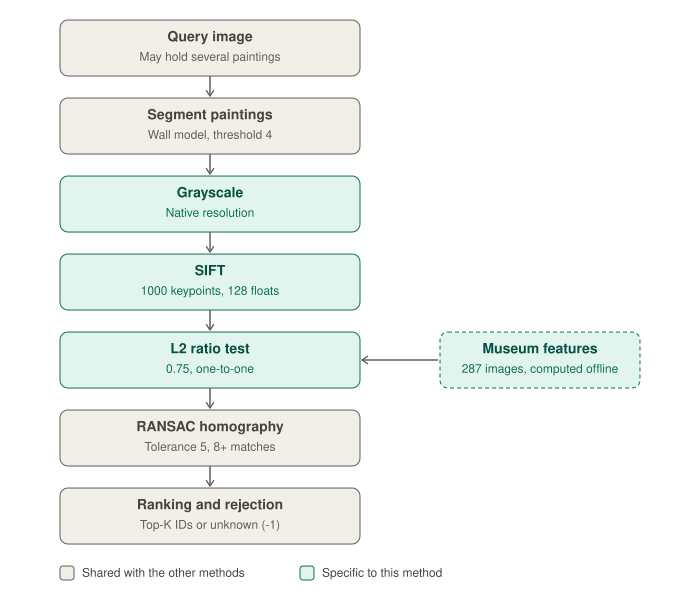
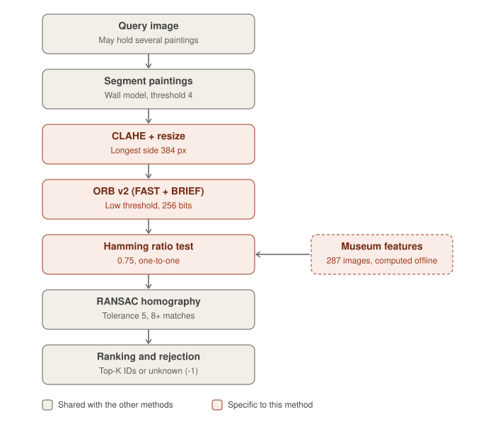
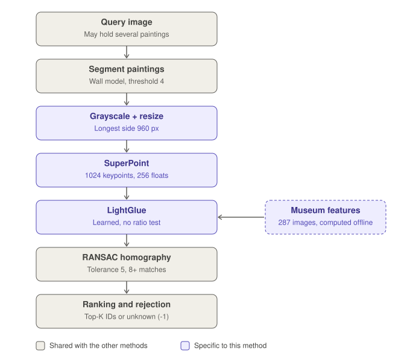
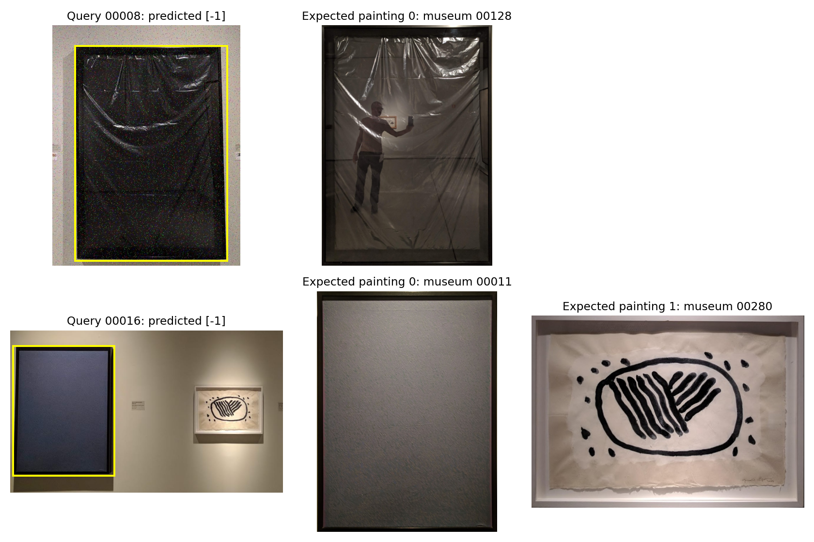
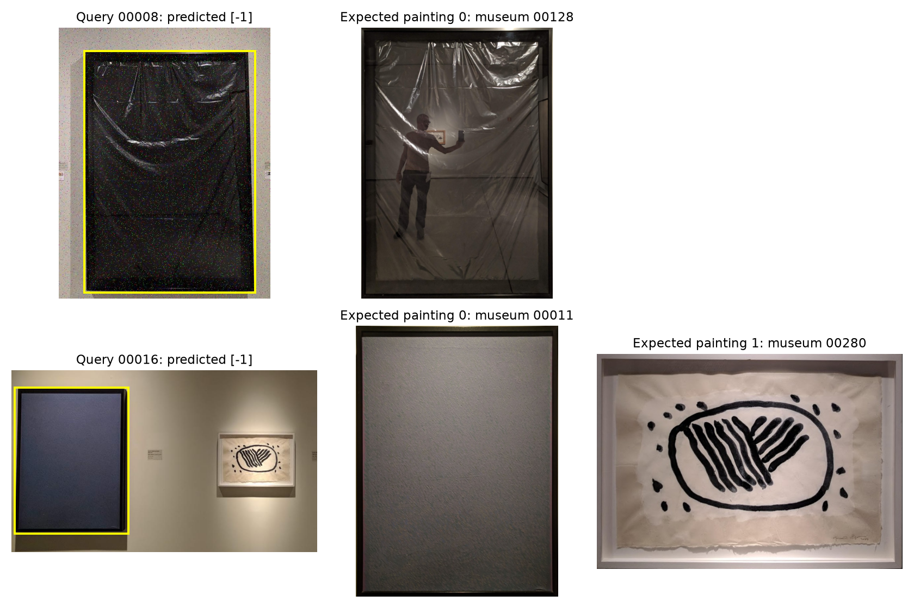
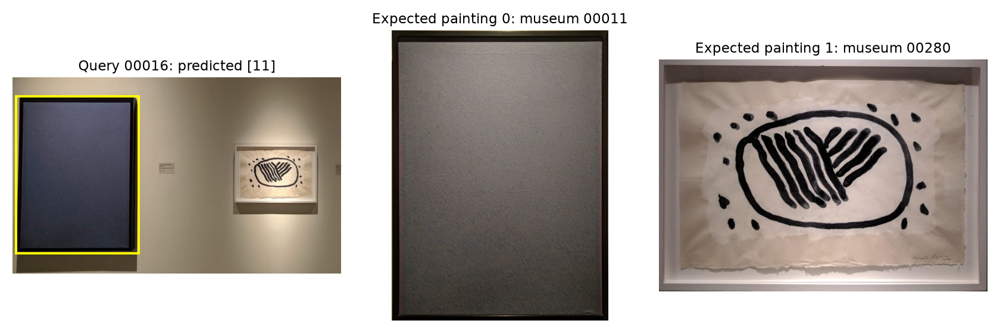

# C1-PROJECT

## Initial Setup

Create a virtual environment to encapsulate the required installations.

1. In your project directory, create the environment:
```powershell
   python -m venv .venv
```
2. Upgrade pip, in case the versions do not coincide:
```powershell
   .\.venv\Scripts\python.exe -m pip install --upgrade pip
```
3. Install the required packages:
```powershell
   .\.venv\Scripts\python.exe -m pip install -r requirements.txt
```
4. Activate the environment (Windows):
```powershell
   .\.venv\Scripts\Activate.ps1
```

> **Note:** Windows PowerShell may restrict running scripts by default. If activation fails, allow execution for the current session with:
> ```powershell
> Set-ExecutionPolicy -Scope Process -ExecutionPolicy Bypass
> ```

---

## Week 1

### Task 1: Image Descriptors

Run:
```powershell
python .\src\methods_w1.py --list
```

The W1 descriptors live in `methods_w1.py` (`METHODS_W1`), with the histogram
implementations in `utils.py`:
- Grayscale
- RGB
- HSV (one component per histogram)
- HSV grid (4×4 cells, 512 values)

### Task 2: Similarity Functions

All similarity formulas are implemented in `k_similarity.py`, and fall into two groups:

| Type | Functions | Interpretation |
|------|-----------|----------------|
| Distances | Euclidean, L1, Chi-square | Lower value = more similar |
| Similarities | Histogram Intersection, Hellinger kernel, Cosine, Correlation | Higher value = more similar |

### Task 3: Retrieval and Evaluation

Run:
```powershell
python .\src\k_similarity.py
```

This script retrieves the top K museum images for each query by comparing image descriptors (Grayscale, HSV, RGB, HSV grid) using the similarity functions.

**Ranking order**
- Distances are sorted in ascending order.
- Similarities (Histogram Intersection and Hellinger kernel) are sorted in descending order. They are listed in the `SIMILARITY_FUNCTIONS` constant, used by `rank_museum_images`.

Sorting a similarity in ascending order would return the least similar images first (scores of 0), which is why this distinction is needed.

**Evaluation metrics**
- **AP@K** measures how accurately the relevant museum images are ranked within the top K results for a single query, using the ground-truth correspondences.
- **mAP@K** averages AP@K across all queries, allowing retrieval performance to be compared across descriptor methods and distance functions for K=1 and K=5.

### Task 4: Blind QST1 submission

From the project directory, give the folders containing the museum and test images:
```bash
python .\src\methods_w2.py --museum .\data\BBDD --queries .\data\qsd1_w2 --method "Lab blocks 1D" --blocks 25 
```

Both arguments accept relative or absolute image-folder paths. Only JPG/JPEG
files directly inside each folder are read. Queries are ordered by numeric filename ID. Museum IDs come from
filenames: `bbdd_00007.jpg` becomes integer `7`.

Each `result.pkl` contains a Python list of lists, with exactly 10 unique Python
integer museum IDs per query, ranked best first.

| Output under `results/week1/QST1/` | Descriptor | Default comparison |
|---|---|---|
| `method1/result.pkl` | HSV | L1 |
| `method2/result.pkl` | HSV grid | L1 |

At most two methods are allowed (statement), so only HSV and HSV grid are
submitted; Grayscale and RGB remain in `METHODS_W1` for validation only.

To override the comparison for both methods or change the output location:
```bash
python src/methods_w1.py --museum data/BBDD --queries data/qst1_w1 --distance Hellinger --output-dir results/hellinger/week1/QST1
```

Available comparisons: `Euclidean`, `L1`, `Chi-square`, `Histogram Intersection`,
`Hellinger`, `Cosine`, and `Correlation`. Quote names containing spaces.

---

## Week 2

### Task 1: Color Histograms

`methods_w2.py` keeps four Lab descriptors (all L1-normalized, with an
optional foreground mask):

| Method | Description | Parameter |
|---|---|---|
| `Lab blocks 1D` | grid of marginal 1D histograms (32 bins per channel), concatenated in row-major order | `--blocks T` total cells, a perfect square (default 25 → 5×5) |
| `Lab 2D` | same grid of cells; each cell is L as a 1D marginal (32 bins) plus the (a, b) pair as a joint 2D histogram (32 bins per axis), concatenated row-major | `--blocks T` (default 25 → 5×5) |
| `Lab 3D` | same grid of cells; each cell is a joint 3D L-a-b histogram (32 bins per axis), concatenated row-major | `--blocks T` (default 25 → 5×5) |
| `Lab pyramid` | hierarchy of 1D-block levels: level 1 is one block, each extra level doubles the number of blocks (1, 2, 4, 8 …) | `--levels K` (default 3) |

Run `python .\src\methods_w2.py --list` to list them.

### Task 2: Retrieval Comparison

Run a W2 method on a museum/query pair (add `--ground-truth` to print mAP):
```powershell
python .\src\methods_w2.py --museum ..\..\datasets\BBDD --queries ..\..\datasets\qsd1_w2 --method "Lab blocks 1D" --blocks 25
```

`--method` is required: a descriptor name or `all` (evaluates the four methods
in one pass). Use `--blocks`/`--levels` for the parametrized methods and
`--distance` for the comparison (default L1).

For example, on QSD1-W2:
```powershell
python .\src\methods_w2.py --museum data\BBDD --queries data\qsd1_w2 --ground-truth data\qsd1_w2\qsd1_w1\gt_corresps.pkl --method all
```

mAP on the 30 QSD1-W2 queries against the BBDD (L1):

| Descriptor | Config | mAP@1 | mAP@5 |
|---|---|---:|---:|
| W1 HSV grid | 4×4 | 0.7667 | 0.8194 |
| W1 HSV grid | 6×6 | 0.8000 | 0.8500 |
| `Lab blocks 1D` | `--blocks 16` | 0.8333 | 0.8722 |
| `Lab blocks 1D` | `--blocks 25` (default) | 0.8667 | 0.8944 |
| `Lab blocks 1D` | `--blocks 36` | 0.8667 | 0.9000 |
| `Lab pyramid` | `--levels 3` | 0.6333 | 0.6744 |
| `Lab pyramid` | `--levels 4` | 0.7333 | 0.7778 |
| `Lab 2D` | `--blocks 1` (1×1) | 0.5333 | 0.6028 |
| `Lab 2D` | `--blocks 25` (default) | 0.8667 | 0.8917 |
| `Lab 3D` | `--blocks 1` (1×1) | 0.4000 | 0.4833 |
| `Lab 3D` | `--blocks 25` (default) | 0.7000 | 0.7472 |

`Lab blocks 1D --blocks 36` gives the best mAP@5 on this set (tied with the
default `--blocks 25` at rank 1). Evaluation with segmentation and blind
queries is still pending.

The extra experiments and their results are in
[results/week2/color_experiments](results/week2/color_experiments).

### Task 3: Background Removal

Method:
1. The outer 4% of the image is used as a sample of the wall.
2. A smooth color model of the wall is fitted in CIE-Lab (a polynomial surface,
   so uneven lighting is handled; frame corners or labels in the strip are
   down-weighted).
3. Each pixel's Mahalanobis distance to that wall model is computed; pixels far
   from the wall are foreground. The threshold is chosen per image (Otsu,
   clipped to 3-12).
4. Cleanup: morphology, keep the largest connected blob, fill holes, and replace
   the blob by its bounding box (paintings are rectangles). Use
   `BGParams(use_bbox=False)` for the pure color mask.

No edge, contour or object detector is used. Masks are saved with the same name
as the image and a `.png` extension (`00001.jpg` -> `00001.png`), values 0
(background) / 255 (painting). `--viz` saves one overlay per image plus
`overview.jpg` (dimmed = removed background, red = our mask, green =
ground truth, F1 on every tile). If the ground-truth masks sit next to the
images (QSD2), the mean P/R/F1 is printed.

### Task 4: Segmentation Evaluation

Run after generating the masks from Task 3:
```powershell
python src\methods_w2.py --segment data\qsd2_w2 --out results\week2\QSD2\masks --viz results\week2\QSD2\viz 
```

The script matches PNG masks by numeric filename ID and computes foreground
precision, recall and F1 for each query. Masks must have the same dimensions
as their reference, with 0 for background and nonzero pixels for foreground.

The table shows the scores for each query and their mean. Use `--save` to
write it to a text file.

Add `--viz` to also draw the masks over the images (`--images` if the `.jpg`
files are not in the ground-truth folder):
```powershell
python src\methods_w2.py --segmentation results\week2\QSD2\masks data\qsd2_w2 --viz results\week2\QSD2\viz --save results\week2\QSD2\mask_metrics.txt
```

Result of Task 3 on the 30 QSD2 images:

| | Precision | Recall | F1 |
|---|---:|---:|---:|
| Mean over the 30 images | 0.9370 | 0.9827 | **0.9569** |

19 of 30 masks have F1 >= 0.95. The weakest are 00020 (white painting on a
light wall, 0.84), 00026, 00014, 00000 and 00013. Most of the lost precision is
the shadow or lighter strip of wall just below a painting.

### Task 5: Retrieval on QSD2 with Background Removal

Add `--background-removal` to the retrieval command: each query is segmented
with Task 3 and the descriptor only counts the painting pixels.
```powershell
python src\methods_w2.py --museum data\BBDD --queries data\qsd2_w2 --ground-truth data\qsd2_w2\qsd2_w1\gt_corresps.pkl --method "Lab pyramid" --levels 7 --background-removal
```

Museum images contain only the painting, but a query has wall around it. The
block grid is laid over the image, so cell (i, j) of the query would cover a
different part of the painting than cell (i, j) of the museum image, even when
the wall pixels are masked out. The query is therefore **cropped to the
bounding box of its mask** before the descriptor is computed. `--no-crop` turns
this off.

mAP@1 / mAP@5 on QSD2 (L1):

| Descriptor | **Mask + crop** | Ground-truth mask + crop |
|---|---:|---:|
| `Lab pyramid --levels 7` | **0.8333 / 0.8483** | 0.8667 / 0.8750 |
| `Lab blocks 1D --blocks 36` | 0.7667 / 0.8139 | 0.8667 / 0.8844 |
| `Lab blocks 1D --blocks 16` | 0.7000 / 0.7556 | 0.7333 / 0.7890 |

The last column uses the ground-truth masks (`--query-masks data\qsd2_w1`) and is
a comparison with the annotated masks. `--background-removal` and
`--query-masks` cannot be used together.

### Task 6: Blind Submission (QST1 and QST2)

```powershell
python src\methods_w2.py --museum data\BBDD --qst1 data\qst_w2\qst1_w2 --qst2 data\qst_w2\qst2_w2
```

Give `--qst1` and/or `--qst2` (the folders must contain the `.jpg` files
directly). Use `--submit-out` to change the output folder (default
`results/week2`) and `--distance` to change the comparison.

| Output under `results/week2/` | Content |
|---|---|
| `QST1/method1/result.pkl` | `Lab blocks 1D`, 6x6 cells (`--blocks 36`), L1, whole image |
| `QST1/method2/result.pkl` | `Lab pyramid`, 7 levels (`--levels 7`), L1, whole image |
| `QST2/method1/result.pkl`, `QST2/method2/result.pkl` | same methods on the painting only (Task 3 mask + crop) |
| `QST2/method1/*.png`, `QST2/method2/*.png` | background masks, same name as the query, 0/255 |

Each `result.pkl` is a Python list of lists with exactly 10 unique integer
museum IDs per query, best first. After writing, the script reads every file
back and checks the IDs, and that each mask exists, has the size of its query
and contains only 0 and 255. The methods are defined in `SUBMISSION_METHODS`
in `methods_w2.py`.

---

## Week 3

The development sets are in `data/qsd1_w3` (30 cropped queries, one painting each)
and `data/qsd2_w3` (30 queries with up to two paintings). Both contain noise and
hue changes. Use the JPG files in these folders; `non_augmented/` contains the
clean reference copies and is not used as query input.

| File | Content |
|---|---|
| `methods_w3.py` | Task 1: query filters (Median, Open, Close, Open+Close, Close+Open, Average, Gaussian, Low-pass Wavelet), the filter sweep, and the HSV hue-invariance mode |
| `paintings_w3.py` | Task 2: texture descriptors (LBP, Multiscale LBP, DCT, Wavelet, and the improved DCT log and Texture fusion); Tasks 3, 4 and 5: multi-painting segmentation, retrieval per painting, blind submission |

`paintings_w3.py` reuses the W2 wall model, ranking, mask evaluation and
overlays. The texture descriptors are the first part of the same file, so
`paintings_w3.py` is self-contained apart from the W2 modules and the Task 1
filter, which it imports from `methods_w3.py` through `--query-filter`.

### Task 1: Noise Filtering

`methods_w3.py` registers one `Lab blocks 1D <filter>` method per filter
(Median, Open, Close, Open+Close, Close+Open, Average, Gaussian, Low-pass
Wavelet) plus the unfiltered `Lab blocks 1D` baseline. All of them use the W2
descriptor (CIE-Lab, 32 bins per channel, 5x5 = 25 cells, L1-normalized) with
the L1 distance, so only the preprocessing changes between methods.

Common options:

| Option | Meaning |
|---|---|
| `--kernel K` | Odd spatial size (>= 3) shared by every filter. **Required**, with no default, so every reported number states its kernel. The wavelet filter uses `--wavelet-level` instead |
| `--filter-scope both` | (default) the filter is applied to the queries **and** the museum images, so both sides share the same filtered domain. `query` filters the queries only |
| `--hue-invariant` | HSV hue-invariance mode: a global hue scale is estimated per (query, museum image) pair and the raw Lab distance is blended with the hue-normalized one. Needs `color_reference` |
| `--hue-reference FILE.npz` | Cache for the museum hue histograms. If the file exists it is **loaded, not rebuilt**, so use one file per filter and kernel |
| `--hue-alpha`, `--hue-temperature` | Blend weight and confidence temperature of the hue correction (default 1.0 each) |

Without `--hue-invariant` the script prints a warning: those numbers do not
include the hue correction and cannot be compared with hue-invariant ones.

**Single-pass comparison at one kernel size.** All methods with the same
kernel (hue-invariance is not available with `--method all`):

```powershell
python src/methods_w3.py --museum data/BBDD --queries data/qsd1_w3 --method all --kernel 5 --ground-truth data/qsd1_w3/gt_corresps.pkl
```

| Method (kernel 5x5) | mAP@1 | mAP@5 |
|---|---:|---:|
| `Lab blocks 1D` (no filter) | 0.6667 | 0.7511 |
| Median | 0.7333 | 0.7944 |
| Average | 0.7333 | 0.7889 |
| Gaussian | 0.7333 | 0.7889 |
| Open | 0.7333 | 0.7806 |
| Close | 0.7000 | 0.7622 |
| Open+Close | 0.7333 | 0.7861 |
| Close+Open | 0.7000 | 0.7789 |

**Kernel search per filter.** The sweep tries every filter over a grid of
sizes (`--kernel` is still required by the parser but the sweep uses its own
grids):

```powershell
python src/methods_w3.py --museum data/BBDD --queries data/qsd1_w3 --sweep --kernel 3 --ground-truth data/qsd1_w3/gt_corresps.pkl
```

Best kernel per filter on QSD1-W3 (`Lab blocks 1D`, L1, 30 queries,
`--filter-scope both`, no hue-invariance):

| Filter | Best kernel | mAP@1 | mAP@5 |
|---|---:|---:|---:|
| none (baseline) | - | 0.6667 | 0.7511 |
| **Median** | **7x7** | **0.7667** | **0.8178** |
| Median (best mAP@5) | 15x15 / 17x17 | 0.7667 | 0.8233 |
| Open+Close | 7x7 | 0.7667 | 0.8028 |
| Average | 9x9 / 11x11 | 0.7333 | 0.7983 |
| Gaussian | 9x9 to 15x15 | 0.7333 | 0.7956 |
| Low-pass Wavelet | level 3 | 0.7333 | 0.7956 |
| Open | 5x5 | 0.7333 | 0.7806 |
| Close+Open | 3x3 | 0.7000 | 0.7722 |
| Close | 3x3 | 0.7000 | 0.7667 |

This table was run **without** `--hue-invariant`. Every filter improves on the
unfiltered baseline (0.7511 mAP@5). Without hue correction the median filter
is the best one: its mAP@5 is flat from 7x7 to 21x21 (0.8122-0.8233), so the
result does not depend on a lucky kernel size. Open+Close is the best
morphological filter (7x7), 0.015 mAP@5 below the median. The final system
uses hue-invariance, so the filters are ranked again with it below.

**Hue-invariance.** The hue correction is added on top of a filter. Use one
cache file per filter and kernel (a stale cache from another filter gives wrong
numbers):

```powershell
python src/methods_w3.py --museum data/BBDD --queries data/qsd1_w3 --method "Lab blocks 1D open+close" --kernel 7 --filter-scope both --hue-invariant --hue-reference results/week3/hue_openclose7.npz --ground-truth data/qsd1_w3/gt_corresps.pkl
python src/methods_w3.py --museum data/BBDD --queries data/qsd1_w3 --method "Lab blocks 1D wavelet" --kernel 7 --wavelet-level 3 --filter-scope both --hue-invariant --hue-reference results/week3/hue_wavelet3.npz --ground-truth data/qsd1_w3/gt_corresps.pkl
```

(`--kernel` is required by the parser but the wavelet filter ignores it and
uses `--wavelet-level`.)

Best kernel per filter on QSD1-W3 with hue-invariance (`--hue-invariant`,
`Lab blocks 1D`, L1, 30 queries, `--filter-scope both`):

| Filter | Best setting | mAP@1 | mAP@5 |
|---|---:|---:|---:|
| none (baseline) | - | 0.7333 | 0.7694 |
| Median | 7x7 | 0.8000 | 0.8317 |
| Open | 9x9 | 0.7667 | 0.8000 |
| Close | 7x7 | 0.7333 | 0.7928 |
| Open+Close | 7x7 | 0.8000 | 0.8278 |
| Close+Open | 7x7 | 0.7667 | 0.8167 |
| Average | 5x5 | 0.8000 | 0.8317 |
| Gaussian | 7x7 | 0.8000 | 0.8317 |
| **Low-pass Wavelet** | **level 3** | **0.8000** | **0.8344** |

Hue-invariance adds 0.067 mAP@1 and 0.0183 mAP@5 to the unfiltered baseline
(0.6667 / 0.7511 without it), and it raises every filter: for example
Open+Close 7x7 goes from 0.7667 / 0.8028 to 0.8000 / 0.8278. Low-pass Wavelet
is the best filter overall, but the margin is small: the median, average and
Gaussian filters are 0.0027 mAP@5 behind it and Open+Close 0.0066, which on 30
queries is at most one query moving one rank. All of them reach mAP@1 0.8000,
so they cannot be told apart at rank 1. The morphological filters Open, Close
and Close+Open are the weakest.

An earlier Open+Close 11x11 run with hue-invariance (0.7333 / 0.7861) is
identical to the no-hue 5x5 result, so it is not used; 7x7 is the best size
for Open+Close in the sweep.

**Why the other filters are kept.** Low-pass Wavelet is the best filter of
this comparison, but all filters stay registered and selectable (`--method`,
`--sweep`) instead of fixing the wavelet for the rest of the project. The
reasons are the following hypotheses:

1. **The result is specific to one system and one set.** The ranking was
   measured for the Lab colour histogram with hue-invariance on the 30 queries
   of QSD1-W3. The margins are small: the wavelet (0.8344) is 0.0027 mAP@5
   above the median, average and Gaussian filters (0.8317) and 0.0066 above
   Open+Close 7x7 (0.8278), with the same mAP@1 (0.8000) for all of them. On 30
   queries these filters are practically tied, so the winner may change with
   another set of queries.
2. **Other descriptors may depend on different image information.** A colour
   histogram with 32 bins per channel uses coarse intensity distributions, so
   it should tolerate a filter that removes fine detail. Texture descriptors
   such as LBP, DCT or wavelet energies are computed from local pixel
   differences and high-frequency content, which a low-pass filter removes. A
   filter that is best for colour is therefore not guaranteed to be best for
   texture, and keeping the alternatives allows to check it for each
   descriptor.
3. **The noise model is unknown and only some queries are noisy.** The task
   does not describe the noise, and the test queries may contain different
   noise from the development ones. A median filter is a robust option for
   isolated outlier pixels and preserves edges, so it is kept as a fallback
   to a filter that was tuned on 30 images.
4. **A common set of filters makes the comparison reproducible.** With every
   filter available under the same interface (`--kernel`, `--wavelet-level`,
   `--filter-scope`), the selection can be repeated for any later descriptor
   or development set, instead of assuming that the winner of one experiment
   transfers to the next.

The texture descriptors of Task 2 use only the grayscale image, so the
HSV hue-invariance step is not used for them. Grayscale conversion alone does
not guarantee invariance to hue changes.

### Task 2: Texture Descriptors

All descriptors extract texture features from the grayscale image rather than
explicit color histograms. Hue changes can still change the converted gray
levels. The image is split into 5x5 = 25 blocks and the block features are
concatenated, which keeps the position of the texture.

| Method | Description | Size |
|---|---|---:|
| `LBP` | 3x3 Local Binary Pattern, 256-bin histogram per block | 6400 |
| `LBP uniform` | same codes, 58 uniform patterns plus one bin for the rest | 1475 |
| `Multiscale LBP` | circular LBP at (P,R) = (8,1), (12,2.5), (16,4), bilinear interpolation, uniform patterns, three histograms per block | 10925 |
| `DCT` | 2D DCT per block, zig-zag scan, first 15 coefficients without the DC term | 375 |
| `Wavelet` | 3-level Haar; mean absolute value of each detail subband per block | 225 |
| `DCT log` | DCT with log-compressed coefficients, sign(c)*log(1+abs(c)) | 375 |
| `Texture fusion` | `DCT log`, square-root `Multiscale LBP` and square-root `Wavelet`, each scaled to unit L2 norm and concatenated | 11525 |

Evaluation on QSD1-W3 with texture only: no segmentation (the queries are
already cropped), no color. `--table` prints a method x distance table (mAP@1
and mAP@10, 30 queries). It is run without a filter and with several Task 1
filters on the queries (the museum images are not filtered). `--denoise N` is a
median filter; any other Task 1 filter is selected with `--filter NAME
--kernel K` (the wavelet needs no kernel).

```powershell
python src/paintings_w3.py --museum data/BBDD --queries data/qsd1_w3 --ground-truth data/qsd1_w3/gt_corresps.pkl --table --method all --distance all
python src/paintings_w3.py --museum data/BBDD --queries data/qsd1_w3 --ground-truth data/qsd1_w3/gt_corresps.pkl --table --method all --distance all --denoise 3
python src/paintings_w3.py --museum data/BBDD --queries data/qsd1_w3 --ground-truth data/qsd1_w3/gt_corresps.pkl --table --method all --distance all --denoise 5
python src/paintings_w3.py --museum data/BBDD --queries data/qsd1_w3 --ground-truth data/qsd1_w3/gt_corresps.pkl --table --method all --distance all --filter average --kernel 5
python src/paintings_w3.py --museum data/BBDD --queries data/qsd1_w3 --ground-truth data/qsd1_w3/gt_corresps.pkl --table --method all --distance all --filter gaussian --kernel 7
python src/paintings_w3.py --museum data/BBDD --queries data/qsd1_w3 --ground-truth data/qsd1_w3/gt_corresps.pkl --table --method all --distance all --filter wavelet_lowpass
python src/paintings_w3.py --museum data/BBDD --queries data/qsd1_w3 --ground-truth data/qsd1_w3/gt_corresps.pkl --table --method all --distance all --filter open+close --kernel 7
```

mAP@1, best distance per descriptor and filter:

| Descriptor | No filter | Median 3x3 | Median 5x5 | Average 5x5 | Gaussian 7x7 | Wavelet L3 | Open+Close 7x7 |
|---|---:|---:|---:|---:|---:|---:|---:|
| `LBP` | 0.800 | 0.600 | 0.533 | 0.500 | 0.500 | 0.300 | 0.233 |
| `LBP uniform` | 0.667 | 0.600 | 0.533 | 0.467 | 0.467 | 0.300 | 0.233 |
| `Multiscale LBP` | 0.900 | 0.967 | 0.967 | 0.933 | 0.933 | 0.533 | 0.367 |
| `DCT` | 0.967 | 0.967 | 0.967 | 0.967 | 0.967 | 0.967 | 0.933 |
| `Wavelet` | 0.833 | 0.867 | 0.867 | 0.833 | 0.867 | 0.633 | 0.633 |
| `DCT log` | **1.000** | **1.000** | **1.000** | **1.000** | **1.000** | **1.000** | 0.967 |
| `Texture fusion` | **1.000** | **1.000** | **1.000** | **1.000** | **1.000** | **1.000** | **1.000** (L1: 0.967) |

Best distances: `DCT` and `DCT log` work with L1, Cosine and Correlation;
`Texture fusion` with L1, Euclidean, Cosine and Correlation (with Open+Close,
L1 drops to 0.967 and the other three keep 1.000); Multiscale LBP with
Hellinger or Chi-square after most filters; Wavelet with L1 or Histogram
Intersection. Euclidean and Cosine are poor for Multiscale LBP.

Observations:

- **`DCT log` and `Texture fusion` are the most robust.** They find the right
  painting at rank 1 for all 30 queries with no filter and with the median,
  average, Gaussian and wavelet filters; only Open+Close 7x7 lowers `DCT log`
  to 0.967. These results show robust retrieval on the noisy, hue-modified
  QSD1-W3 queries; plain `DCT` is also stable (0.933-0.967). A likely reason is
  that the DCT parts keep only the first 15 zig-zag coefficients of each block,
  which are low frequencies, and the filters mostly change the high frequencies.
  The fusion inherits this stability from its `DCT log` part.
- **The LBP histograms get worse as the smoothing gets stronger.** Plain LBP
  goes from 0.800 (no filter) to 0.600 (median), 0.500 (average, Gaussian),
  0.300 (wavelet) and 0.233 (Open+Close). The code of a pixel depends on the
  sign of its differences with the neighbours, so a filtered query has other
  codes than the unfiltered museum image it should match. The strongest
  filters (wavelet, Open+Close) remove most of the local variation, and this
  gives the largest drop.
- **Multiscale LBP and the Haar `Wavelet` descriptor benefit from mild
  filters and fail with strong ones.** Multiscale LBP rises from 0.900 to
  0.967 with the median and 0.933 with the average and Gaussian filters, but
  falls to 0.533 (wavelet) and 0.367 (Open+Close). `Wavelet` goes from 0.833
  to 0.867 with the median and Gaussian filters and falls to 0.633 with the
  wavelet and Open+Close. Both use larger neighbourhoods or subband energies,
  so removing isolated noise pixels helps them, but removing the real fine
  texture does not.
- **The filter has to be tuned to the descriptor.** The same filter can
  improve one descriptor and damage another, so the table is read per column
  and not only per row.

#### Texture fusion (final descriptor)

`Texture fusion` is the descriptor submitted for Tasks 4 and 5. It joins three
texture descriptors that look at the image in different ways, using only the
grayscale image (no color):

| Part | What it captures | How it is computed | Size |
|---|---|---|---:|
| `DCT log` | Frequency content of each block (coarse to fine texture) | gray image resized to 255x255, 25 blocks of 51x51; 2D DCT per block; zig-zag scan; the DC term (mean brightness) is dropped and the next 15 coefficients are kept; each coefficient c becomes sign(c)*log(1+abs(c)) | 375 |
| Multiscale LBP | Local micro-patterns (edges, spots, flat areas) at three scales | gray image with the longest side at 256 px; circular LBP at (P,R) = (8,1), (12,2.5), (16,4); uniform patterns; one histogram per block and scale; L1 normalization; square root | 10925 |
| Wavelet | Oriented detail energy at three scales | gray image resized to 256x256; 3-level Haar; mean absolute value of the horizontal, vertical and diagonal details in each block; L1 normalization; square root | 225 |

The final vector is `[DCT log / ||DCT log||, MLBP / ||MLBP||, Wavelet / ||Wavelet||]`:
every part is divided by its own L2 norm and the three are concatenated with
the same weight (11525 values). No weight was tuned.

Why each step is there:

- **DCT without the DC term.** The DC coefficient is the mean brightness of
  the block, which is not texture and changes with lighting. Skipping it makes
  the descriptor insensitive to brightness shifts.
- **Log on the DCT coefficients.** The low-frequency coefficients are much
  larger than the others, so in a plain L1 or Euclidean distance they dominate
  and the fine texture is ignored. The log compresses that range, so every
  coefficient counts, and it also reduces the effect of noise and contrast
  changes. This step alone moves `DCT` from 0.7436 to 0.7692 on QSD2-W3.
- **Square root on the histograms.** LBP and wavelet values are L1-normalized
  histograms. After a square root, the Euclidean distance between two vectors is
  the Hellinger distance between the histograms, which is a better measure for
  histograms and reduces the weight of very frequent patterns.
- **Unit L2 norm per part.** The three parts have very different sizes (375,
  10925, 225 values) and scales. Without this step the long LBP part would
  dominate the distance; with it, each part contributes comparably.
- **Grayscale only.** No explicit color descriptor is used, although hue changes
  can still affect the gray levels. LBP is invariant to strictly increasing
  transformations of the gray levels.

Why the fusion works: the three parts are complementary. The DCT describes
global frequency content per block, LBP describes the local structure of the
pixels, and the wavelet describes how much detail there is and in which
direction. A painting that is ambiguous for one of them is usually
separated by another. This is visible in the results: on QSD2-W3 the best single
descriptor reaches mAP@1 0.7692, while the fusion reaches 0.9231 (+0.154, 3x3
median run), and on QSD1-W3 it finds all 30 paintings at rank 1.

The default distance is L1; on QSD1-W3 the fusion gives 1.000 with L1,
Euclidean, Cosine and Correlation, so it does not depend on one distance.
Because the vector contains signed DCT values, Chi-square, Histogram
Intersection and Hellinger are not valid for it. The cost is a longer vector
(11525 values) and a slower descriptor computation than a single descriptor,
which is acceptable for 287 museum images and 30 to 50 queries.

### Task 3: Background Removal for Multiple Paintings

```powershell
python src/paintings_w3.py --segment data/qsd2_w3 --out results/week3/QSD2/masks --viz results/week3/QSD2/viz
```

The method follows the W2 Lab wall model and Mahalanobis distance. The wall
is sampled from the outer 2% of the image. Closing connects thin frame edges
before opening removes small speckles. Instead of keeping only the largest
component, up to two components are kept, each above 2% of the image area.
Overlapping boxes are merged and each painting gets its own bounding box.
The mask is the union of these boxes, with the wall between them left out.

Masks keep the query name and original dimensions, with 0 for background and
255 for foreground. `segmentation.json` records crop boxes and per-image
metrics. The overlays use the W2 convention: red prediction, green ground
truth. Evaluate saved masks with the same W2 metrics:

```powershell
python src/paintings_w3.py --segmentation results/week3/QSD2/masks data/qsd2_w3 --save results/week3/QSD2/mask_metrics.txt
```

To evaluate several method outputs stored below one directory (for example
`all_methods/dct`, `all_methods/lbp`, and `all_methods/wavelet`), pass the
parent directory. The saved report contains one labeled section per method:

```powershell
python src/paintings_w3.py --segmentation results/week3/QSD2/all_methods data/qsd2_w3 --save results/week3/QSD2/mask_metrics_all.txt
```

Results on the 30 augmented QSD2-W3 queries (segmentation does not depend on
the query filter or on the descriptor):

| Method | Precision | Recall | F1 | Correct painting count |
|---|---:|---:|---:|---:|
| W2, largest component only | 0.9631 | 0.7330 | 0.8076 | 21/30 |
| W3, two components, W2 4% border | 0.9622 | 0.9227 | 0.9348 | 29/30 |
| W3, two components, 2% border | 0.9577 | 0.9573 | **0.9526** | **29/30** |

The border width was selected on this development set. The comparison is
saved in `results/week3/QSD2/segmentation_comparison.csv`. Query 00002 still
loses the smaller painting; 00010 loses the dark lower part of the painting.

### Task 4: Retrieval per Painting

Final command: `Texture fusion`, L1, queries filtered with a 3x3 median
filter (Task 1 filter, chosen on QSD2-W3):

```powershell
python src/paintings_w3.py --museum data/BBDD --queries data/qsd2_w3 --background-removal --ground-truth data/qsd2_w3/gt_corresps.pkl --method "Texture fusion" --distance L1 --filter median --kernel 3 --top-k 10 --output-dir results/week3/QSD2/texture_fusion
```

Each painting is cropped separately, then compared with the museum images.
Paintings in the same row are ordered left to right; vertically separated
paintings are ordered top to bottom. Queries follow numeric filename order.
If segmentation finds nothing, retrieval uses the full image and records
the fallback; the saved segmentation mask remains empty.

The default method is `Texture fusion` with the L1 distance. Choose another one
with `--method NAME` (`--method all` runs every texture method, saving each one
in its own subfolder) and `--distance NAME`.

Query filter options (applied to every painting crop before its descriptor):

| Option | Meaning |
|---|---|
| `--filter NAME` | Any Task 1 filter: `median`, `open`, `close`, `open+close`, `close+open`, `average`, `gaussian`, `wavelet_lowpass`, or `none`. Without this option retrieval uses `wavelet_lowpass` (level 3); `--table` uses `none` |
| `--kernel K` | Odd kernel size of the spatial filters (required for them) |
| `--wavelet`, `--wavelet-level` | Family and level of `wavelet_lowpass` (default `db2`, 3); no kernel is needed |
| `--filter-scope {query,both}` | Filter only the query crops (default) or the museum images too |
| `--query-filter module:function` | Custom `fn(rgb) -> rgb`, instead of `--filter` |

The wavelet filter needs the `PyWavelets` package. The filter name and scope
are saved in `retrieval.json`.

#### Effect of the Task 1 filter on the texture pipeline

`Texture fusion`, L1, QSD2-W3, predicted crops (30 queries, 39 paintings). The
segmentation is the same in every run (F1 0.9526, painting count correct in
29/30), so the differences come only from the filter:

| Query filter | Scope | mAP@1 | mAP@5 | mAP@10 |
|---|---|---:|---:|---:|
| none | - | 0.7949 | 0.8192 | 0.8192 |
| **Median 3x3** | query | **0.9231** | **0.9231** | **0.9231** |
| Low-pass Wavelet (level 3) | both | 0.8462 | 0.8739 | 0.8739 |
| Open+Close 7x7 | query | 0.7436 | 0.7607 | 0.7675 |

```powershell
python src/paintings_w3.py --museum data/BBDD --queries data/qsd2_w3 --background-removal --ground-truth data/qsd2_w3/gt_corresps.pkl --method "Texture fusion" --distance L1 --top-k 10 --filter none --output-dir results/week3/QSD2/tests/none
python src/paintings_w3.py --museum data/BBDD --queries data/qsd2_w3 --background-removal --ground-truth data/qsd2_w3/gt_corresps.pkl --method "Texture fusion" --distance L1 --top-k 10 --filter median --kernel 3 --output-dir results/week3/QSD2/tests/median3
python src/paintings_w3.py --museum data/BBDD --queries data/qsd2_w3 --background-removal --ground-truth data/qsd2_w3/gt_corresps.pkl --method "Texture fusion" --distance L1 --top-k 10 --filter wavelet_lowpass --filter-scope both --output-dir results/week3/QSD2/tests/wavelet_both
python src/paintings_w3.py --museum data/BBDD --queries data/qsd2_w3 --background-removal --ground-truth data/qsd2_w3/gt_corresps.pkl --method "Texture fusion" --distance L1 --top-k 10 --filter open+close --kernel 7 --output-dir results/week3/QSD2/tests/openclose7
```

Per descriptor, L1, 3x3 median on the queries (`--method all`):

| Descriptor | mAP@1 | mAP@5 | mAP@10 |
|---|---:|---:|---:|
| W2 Lab pyramid, 7 levels (baseline, no filter) | 0.7436 | 0.7564 | - |
| `LBP uniform` | 0.5128 | 0.5650 | 0.5723 |
| `LBP` | 0.6154 | 0.6603 | 0.6639 |
| `Wavelet` | 0.6923 | 0.7205 | 0.7248 |
| `Multiscale LBP` | 0.7179 | 0.7231 | 0.7231 |
| `DCT` | 0.7436 | 0.7436 | 0.7436 |
| `DCT log` | 0.7692 | 0.8085 | 0.8085 |
| **`Texture fusion`** | **0.9231** | **0.9231** | **0.9231** |

Without a filter, the first run gave `LBP` 0.6154, `LBP uniform`
0.5641, `Multiscale LBP` 0.6410, `DCT` 0.7436 and `Wavelet` 0.6923 (mAP@1). The
median filter helps Multiscale LBP (+0.077) and lowers LBP uniform (-0.051).
With the median filter, `Texture fusion` is 0.154 above `DCT log`, the best single
descriptor (mAP@1: 0.9231 vs. 0.7692). Of the 39 paintings, 36 are correct at
rank 1; the missing ones come from the image with a wrong painting count and
from weak masks, so segmentation is now the main limit.

#### Discussion: why the filter matters, and why the median wins

1. **The noise corrupts the texture descriptors.** The noisy queries have
   isolated, randomly coloured pixels (see the QSD1-W3 examples). LBP compares
   every pixel with its neighbours, so one wrong pixel changes the code of
   itself and of its eight neighbours; the DCT and the wavelet details pick up
   the same pixels as spurious high-frequency energy. The museum images do not
   have this noise, so the unfiltered query and its museum image look like
   different textures. This is why `Texture fusion` reaches only 0.7949 without
   a filter.
2. **The median removes this noise and keeps the texture.** An isolated outlier
   is never the median of its 3x3 neighbourhood, so it is replaced by a value
   from the surrounding painting, while edges and strokes wider than two pixels
   survive. This brings the query back close to its clean museum image, which
   explains the gain of +0.128 mAP@1 (0.7949 to 0.9231). The small kernel
   matters: the texture descriptors work on fine detail, so a filter that
   changes more than the outlier pixels also changes the signal that is being
   matched.
3. **The low-pass wavelet helps, but less (0.8462).** It removes the noise
   because it zeroes every detail coefficient of the first three levels, but it
   zeroes the genuine fine texture too, which the LBP, wavelet and high-order
   DCT parts of the fusion need. It was applied to both queries and museum, so
   the two sides are blurred in the same way and remain comparable, which is
   probably why it still beats no filter; but the information that was
   removed cannot be recovered, so it stays below the median.
4. **Open+Close 7x7 hurts (0.7436, below no filter).** Opening and closing
   with a 7x7 element flatten every bright or dark structure smaller than the
   element, and this includes the small strokes and grain that make up the
   texture. In flat areas, the LBP comparison (neighbour >= centre) gives the
   same code everywhere, so the histograms change a lot. As this filter was
   applied to the queries only, the query is now much smoother than the sharp
   museum image it should match, and the mismatch is bigger than the noise it
   removed.
5. **The best filter for colour is not the best for texture.** In Task 1 the
   Lab colour histogram (32 bins per channel, hue-invariant) preferred the
   low-pass wavelet and Open+Close 7x7, since colour histograms depend on
   coarse intensity distributions and are barely affected by losing fine
   detail. The texture descriptors depend on exactly that fine detail, so the
   ranking reverses: median > wavelet > none > Open+Close. A filter must be
   selected for the descriptor that it feeds, and this is why Task 4 repeats the
   comparison.
6. **The remaining error is segmentation.** All runs share the same masks. With
   the median filter, the 3 wrong paintings out of 39 come from the image with
   a wrong painting count and from weak masks, so a better descriptor or filter
   would not change much. `mAP@1 = mAP@5` shows that when the painting is
   found, it is already at rank 1.

Limits of this comparison: the four runs differ in the filter **and** in the
scope (the wavelet was applied to queries and museum, the others to the queries
only), and each filter was tested with one kernel size. The explanations above
fit the results, but they were not isolated by separate experiments. To
isolate them, run the median with `--filter-scope both`, the wavelet with
`--filter-scope query`, and the median with `--kernel 5` and `7`.

Evaluation computes AP separately for each painting in annotation order.
Missing or extra paintings contribute zero; the mean is taken over painting
slots, so an image with two paintings contributes two scores. Count accuracy
is reported separately. These results use the development correspondences.

`retrieve_folder_w3` accepts a `descriptor(rgb)` callable, shared by museum
images and query crops, and an optional `query_filter(rgb)` applied to the
queries (and to the museum images with `filter_scope="both"`). The CLI builds
the filter from `--filter`/`--kernel`, or loads `--descriptor module:function`
and `--query-filter module:function`, for example
`--descriptor paintings_w3:dct_log_descriptor`.

Outputs in the chosen folder:

| File | Content |
|---|---|
| `result.pkl` | query -> painting -> 10 ranked integer museum IDs |
| `*.png`, `segmentation.json` | masks and crop boxes when using background removal |
| `retrieval.json` | rankings, configuration (including the filter name and scope), fallbacks and evaluation metrics |

Even a query with one painting has the extra list level: `[[[7, 25, ...]],
[[44, 81, ...], [3, 9, ...]], ...]`. The result file is read back and checked
for list sizes, unique IDs and Python integers.

### Task 5: Blind Submission (QST1 and QST2)

Only the best method is submitted, one per test set: `Texture fusion`, L1,
3x3 median filter on the queries, top 10. Every `result.pkl` has the extra list
level (a list of one or two painting rankings per query).

QST1-W3 has cropped pictures with one painting, so segmentation is not used and
the whole image is the painting. QST2-W3 has pictures with background and up to
two paintings, so segmentation is used and the masks are submitted.

```powershell
python src/paintings_w3.py --museum data/BBDD --queries data/qst1_w3 --method "Texture fusion" --distance L1 --filter median --kernel 3 --top-k 10 --output-dir results/week3/QST1/method1
python src/paintings_w3.py --museum data/BBDD --queries data/qst2_w3 --background-removal --method "Texture fusion" --distance L1 --filter median --kernel 3 --top-k 10 --output-dir results/week3/QST2/method1
```

| Output | Content |
|---|---|
| `Team1/week3/QST1/method1/result.pkl` | 50 queries, one painting ranking each |
| `Team1/week3/QST2/method1/result.pkl` | 30 queries, one or two painting rankings each |
| `Team1/week3/QST2/method1/*.png` | background masks, same name as the query, 0/255 |

Only these files are delivered; `segmentation.json` and `retrieval.json` in the
same folders are for our own records.

---

## Week 4

QSD1-W4 contains 30 queries and 39 paintings: 29 belong to the museum and
10 are unknown (`-1`). We use the JPG files directly in `data/qsd1_w4`,
not the clean copies in `non_augmented/`. Museum images are in `data/BBDD`.

Week 4 replaces the global descriptors of Weeks 1-3 by **local features**:
keypoints and local descriptors are computed on the museum images and on every
query painting, tentative matches are found by comparing descriptors, and the
matches are verified geometrically. We built the full system with **SIFT**,
then developed a second method with **ORB** and a third one with learned
**SuperPoint + LightGlue** features, keeping every other step of the pipeline
fixed so that the descriptors can be compared. These are the three descriptors
the assignment allows at most (ORB v1 and v2 are two settings of the same
descriptor). The sections below follow that path: SIFT (Tasks 1-2), the step
from SIFT to ORB, SuperPoint + LightGlue, the evaluation with a discussion of how
the methods behave (Task 3) and the submission (Task 4). The submitted method is
ORB v2, which has the best development score and the lowest cost; the discussion
also weighs the risks of that choice.

### Tasks 1 and 2: SIFT and Matching

`keypoints_w4.py` extracts SIFT descriptors from grayscale images, with
`nfeatures=1000`. `extract_features_w4.py` processes the museum and each
detected query crop, saving descriptors, keypoint coordinates and crop boxes.
Query segmentation reuses the W3 wall model with a fixed distance threshold
of 4. The original adaptive threshold and fixed thresholds 3, 4, 5 and 6 were
compared on QSD1-W4:

| Segmentation | Mask precision | Mask recall | Mask F1 | Correct painting count |
|---|---:|---:|---:|---:|
| W3 adaptive | 0.9036 | 0.8020 | 0.8358 | 25/30 |
| Fixed threshold 3 | 0.8724 | 0.9630 | 0.9140 | 27/30 |
| **Fixed threshold 4** | **0.9103** | **0.9424** | **0.9244** | **28/30** |
| Fixed threshold 5 | 0.9267 | 0.8961 | 0.9050 | 26/30 |
| Fixed threshold 6 | 0.8991 | 0.7786 | 0.8099 | 22/30 |

Threshold 4 gives the best mask F1 and painting count among these settings.
If no painting is found, the whole image is used as a fallback. This happens
on query 00026. A fallback is still a prediction, so retrieval count accuracy
can differ from the segmentation count in this table.

```bash
python src/extract_features_w4.py --museum data/BBDD --output results/week4/sift/museum
python src/extract_features_w4.py --queries data/qsd1_w4 --segmentation-threshold 4 --output results/week4/sift/qsd1_w4_threshold4
```

`matching_w4.py` compares SIFT vectors with L2 distance and a nearest-neighbour
ratio test of 0.75. A museum descriptor can be matched only once. Pairs with
at least 8 tentative matches are checked with a RANSAC homography. Coordinates
are scaled to a reference longest side of 1000 pixels, with a RANSAC tolerance
of 5. Museum candidates are ranked by verified matches, then tentative matches,
then museum ID to break ties.



*Figure: SIFT pipeline (Tasks 1 and 2). Gray boxes are shared by the three methods; colored boxes are specific to the method.*

`batch_matching_w4.py` runs this over all crops. It also selects an unknown
rejection threshold by maximizing unknown-positive F1 on the development set.
Every threshold that changes a prediction is considered; equal-F1 ties use
the smaller threshold. Prediction uses this saved calibration without reading GT.

We also compared L1 and L2 descriptor distances with the same ratio test,
RANSAC settings and crops. Each distance has its own F1 threshold sweep:

| SIFT distance | Selected minimum inliers | mAP@1 | Unknown F1 |
|---|---:|---:|---:|
| L2 | 8 | 0.9231 | 0.9091 |
| L1 | 8 | 0.9231 | 0.9091 |

Both give the same final metrics, so we keep the original L2 configuration.
Use `--distance L1` in the matching command to repeat the alternative.

```bash
python src/batch_matching_w4.py match --museum-features results/week4/sift/museum --query-features results/week4/sift/qsd1_w4_threshold4 --output results/week4/batch/matching_scores.json
python src/batch_matching_w4.py tune --scores results/week4/batch/matching_scores.json --ground-truth data/qsd1_w4/gt_corresps.pkl --output results/week4/batch/calibration.json
```

The original feature indices contain image paths from the computer on which
they were extracted. To draw matches locally, pass `--query-images data/qsd1_w4`
and `--museum-images data/BBDD` to `matching_w4.py`.

### From SIFT to ORB

#### Starting point and motivation

With SIFT, the system reaches mAP@1 0.9231 and unknown F1 0.9091 on QSD1-W4
(Task 3 below), a large improvement over the Week 3 texture method. Its
remaining problems suggested what a second method should address:

- **Two known paintings are rejected as unknown.** With the selected threshold
  of 8 verified matches, the noisy painting of query 00008 (museum 128) has only
  6 inliers and is returned as `[-1]`.
- **Some crops give no keypoints at all.** In query 00016 the left crop has no
  SIFT keypoints, so it cannot match anything and is rejected.
- **SIFT descriptors are heavy.** Each one is 128 floating-point values
  (512 bytes) compared with an L2 distance; a query crop is matched against 287
  museum images, so matching cost is dominated by these float distances.

The task statement lists several local descriptors and asks us to test at most
three. We chose **ORB (oriented FAST + rotated BRIEF)** as the second method for
three reasons. It belongs to a different family from SIFT, so a comparison is
informative: a corner detector with binary descriptors against a scale-space
blob detector with gradient histograms. Its descriptor is a 256-bit string
(32 bytes, 16 times smaller than SIFT's) compared with the Hamming distance,
which is much cheaper than the L2 distance. And it is included in OpenCV's main
module, so it needs no extra packages.

#### How ORB works

1. **Keypoint detection (oriented FAST).** FAST marks a pixel as a corner when
   a contiguous arc of pixels on a circle around it is all brighter or all
   darker than the centre by more than a *threshold* (OpenCV default 20 gray
   levels). Candidates are ranked with the Harris corner measure and only the
   best 1000 are kept. To handle scale, detection runs on an 8-level image
   pyramid with a factor of 1.2 between levels, so a painting seen at a different
   size still produces corners at one of the levels.
2. **Orientation.** The angle of each keypoint is the direction from the patch
   centre to its intensity centroid, which makes the descriptor rotation
   invariant.
3. **Descriptor (rotated BRIEF).** The patch (31x31 pixels) is smoothed and 256
   pairs of pixels are compared (is the first darker than the second?). The
   pairs are rotated by the keypoint angle, and the 256 binary outcomes form the
   descriptor.
4. **Distance.** Two descriptors are compared by the Hamming distance, the
   number of differing bits. L1 and L2 are not meaningful for bit strings.

There are two trade-offs relative to SIFT: the scale handling is a coarse
pyramid rather than a continuous scale space, and FAST depends on an absolute
intensity difference, so low-contrast regions produce few corners. The second
point turned out to matter (see ORB v2).

#### Implementation

Only the feature extractor and the distance change; everything else is shared
with the SIFT pipeline, so that differences in the results come from the
features:

| Step | SIFT | ORB |
|---|---|---|
| Crops | `segment_paintings`, fixed threshold 4, whole-image fallback | identical |
| Keypoints per crop | 1000, native resolution | 1000, crop resized to a longest side of 384 px (never enlarged) and mapped back |
| Descriptor | 128 floats, L2 | 256 bits (32 bytes), Hamming |
| Ratio test | 0.75, one-to-one | identical |
| Verification | RANSAC homography, tolerance 5 at reference size 1000, at least 8 tentative matches | identical |
| Ranking and rejection | verified, tentative, ID; threshold maximising unknown F1 | identical |
| Feature index | `index.json` + one `.npz` per painting | identical layout |



*Figure: ORB v2 pipeline. Gray boxes are shared by the three methods; colored boxes are specific to the method.*

| File | Content |
|---|---|
| `keypoints_orb.py` | `extract_orb` (keypoints and descriptors of one image, for both variants: `--variant v1` or `v2`) and a single-image drawing |
| `matching_orb.py` | `match_orb` (ratio test with Hamming distance, one-to-one matches, RANSAC), with the same output as `match_sift` |
| `extract_features_orb.py` | batch extraction for the museum and the query crops, `--variant v1` or `--variant v2` (default) |
| `batch_matching_orb.py` | `match`, `tune` and `predict`, as for SIFT; refuses museum and query features extracted with different variants |

Resizing the crops to 384 px gives the detector the same working scale for every
crop, and the keypoint coordinates are mapped back to the crop's resolution so
that the RANSAC tolerance behaves as in the SIFT pipeline.

```bash
python src/extract_features_orb.py --museum data/BBDD --output results/week4/orb/museum --variant v1
python src/extract_features_orb.py --queries data/qsd1_w4 --output results/week4/orb/qsd1_w4 --variant v1
python src/batch_matching_orb.py match --museum-features results/week4/orb/museum --query-features results/week4/orb/qsd1_w4 --output results/week4/orb/scores_qsd1_w4.json
python src/batch_matching_orb.py tune --scores results/week4/orb/scores_qsd1_w4.json --ground-truth data/qsd1_w4/gt_corresps.pkl --output results/week4/orb/calibration.json
```

#### ORB v1: default settings

With OpenCV's default FAST threshold, the unknown-rejection sweep selects 6
verified matches:

| Min. inliers | Unknown precision | Unknown recall | Unknown F1 | mAP@1 |
|---:|---:|---:|---:|---:|
| 1 | 0.8571 | 0.6000 | 0.7059 | 0.8205 |
| 5 | 0.9000 | 0.9000 | 0.9000 | 0.8974 |
| **6** | 0.8333 | 1.0000 | **0.9091** | **0.9231** |
| 22 | 0.7692 | 1.0000 | 0.8696 | 0.8974 |

ORB v1 therefore matches SIFT (mAP@1 0.9231, unknown F1 0.9091), but with
cheaper descriptors. It also shows the same kind of error: 2 known paintings are
rejected as unknown.

#### Error analysis: why known paintings are rejected

Instead of only tuning the threshold, we looked at the best inlier count of each
query painting. The queries whose best match has 0 inliers are also the ones
with very few ORB keypoints in their crop:

| Query | 00000 | 00007 | 00016 | 00017 | 00021 | 00029 |
|---|---:|---:|---:|---:|---:|---:|
| ORB v1 keypoints in the crop | 23 | 34 | 0 | 128 | 193 | 164 |
| Best verified matches | 0 | 0 | 0 | 0 | 0 | 0 |

A normal crop gives 700-1000 keypoints. Of these six queries, five (00000,
00007, 00017, 00021, 00029) are genuine unknown paintings, for which 0 inliers
is the right outcome. The sixth, 00016, contains a known painting (the left
one, museum 11): its crop has no ORB keypoints, so there is nothing to verify
and it is rejected as unknown whatever threshold is chosen. The other known
painting rejected by v1 is the noisy painting of 00008 (museum 128). It is not
a keypoint-starvation case: it reaches 5 verified matches, one below the v1
threshold of 6. QSD1-W4 includes paintings with
colour changes, and a washed-out painting has weak local contrast. Our
hypothesis was that the FAST threshold (20 gray levels) is too strict for
them. We checked this on a Week 1 query image with its contrast artificially
reduced to 15%: the default detector found 0 keypoints, a threshold of 7 found
57, and a threshold of 7 combined with CLAHE (contrast-limited adaptive
histogram equalisation, which stretches the local contrast) found 658. The
result on QSD1-W4 below is the real test of the hypothesis.

#### ORB v2: low FAST threshold and CLAHE

| Variant | FAST threshold | Contrast equalisation | Folder |
|---|---:|---|---|
| ORB v1 | 20 (OpenCV default) | no | `results/week4/orb` |
| **ORB v2** | **7** | **CLAHE (clip limit 3, 8x8 tiles) on the grayscale crop** | `results/week4/orb_v2` |

Both variants use the same code, selected with `--variant v1` or `--variant v2`
(the default). `--fast-threshold N` and `--clahe/--no-clahe` override a single
setting; the index then records the variant as `custom`. The settings must be
the same for the museum images and for the queries: if only the queries were
equalised, the same painting would be described from two different images, and
its descriptors would be less similar. `extract_features_orb.py` stores the
variant, FAST threshold and CLAHE in `index.json`; `match` stops if the museum
and query folders differ, and `predict` stops if the calibration was made with
different settings.

```bash
python src/extract_features_orb.py --museum data/BBDD --output results/week4/orb_v2/museum --variant v2
python src/extract_features_orb.py --queries data/qsd1_w4 --output results/week4/orb_v2/qsd1_w4 --variant v2
python src/batch_matching_orb.py match --museum-features results/week4/orb_v2/museum --query-features results/week4/orb_v2/qsd1_w4 --output results/week4/orb_v2/scores_qsd1_w4.json
python src/batch_matching_orb.py tune --scores results/week4/orb_v2/scores_qsd1_w4.json --ground-truth data/qsd1_w4/gt_corresps.pkl --output results/week4/orb_v2/calibration.json
```

A single crop can be inspected with
`python src/keypoints_orb.py --image data/qsd1_w4/00000.jpg --output results/week4/orb_v2/00000_kp.jpg --variant v2`.

| Min. inliers | Unknown precision | Unknown recall | Unknown F1 | mAP@1 |
|---:|---:|---:|---:|---:|
| 1 | 1.0000 | 0.2000 | 0.3333 | 0.7692 |
| 5 | 1.0000 | 0.5000 | 0.6667 | 0.8462 |
| **6** | **1.0000** | **1.0000** | **1.0000** | **0.9744** |
| 8 | 0.8333 | 1.0000 | 0.9091 | 0.9231 |
| 19 | 0.7692 | 1.0000 | 0.8696 | 0.8974 |

The two known paintings that v1 rejected (00008 and the left painting of 00016)
are now matched, and the separation between known and unknown paintings is
clean: the best match of every unknown painting has at most 5 verified matches
and the weakest known painting has 7, so thresholds 6 and 7 give the same result
on this set. The gap is narrow (a ratio of 1.4), and the threshold was tuned on
these same 30 queries. The low-contrast hypothesis is supported for 00016, whose
crop goes from no keypoints to 7 verified matches, but the gains are small: both
recovered paintings pass the threshold by a single match.

#### Evaluation

Each variant has its own features, scores and calibration (`results/week4/orb`
for v1 and `results/week4/orb_v2` for v2, created by the `extract`, `match` and
`tune` commands above). Development predictions of each variant, with the
calibrated rejection threshold:

```bash
# ORB v1
python src/batch_matching_orb.py predict --scores results/week4/orb/scores_qsd1_w4.json --calibration results/week4/orb/calibration.json --output results/week4/orb/qsd1_w4_result.pkl
# ORB v2
python src/batch_matching_orb.py predict --scores results/week4/orb_v2/scores_qsd1_w4.json --calibration results/week4/orb_v2/calibration.json --output results/week4/orb_v2/qsd1_w4_result.pkl
```

To evaluate both variants and compare them with the Week 3 system in one run,
from the project root (`--queries` must be given, because its default is a Week 3
folder):

```bash
python src/evaluate_orb.py --queries data/qsd1_w4 --with-v1 --rematch
```

`--rematch` recomputes the matching from the saved features. To skip this slow
step, drop `--rematch` and the saved scores are reused (`--scores` for v2 and
`--scores-v1` for v1, which default to
`results/week4/orb_v2/scores_qsd1_w4.json` and
`results/week4/orb/scores_qsd1_w4.json`).

ORB v2 is always evaluated and `--with-v1` adds ORB v1 as a second row. The
rejection threshold of each variant is calibrated on the unknown paintings with
the same F1 sweep as for the other methods, and `--skip-w3` leaves out the slow
Week 3 baseline. Outputs are under `evaluations/orb/` (`--output`):

| File | Content |
|---|---|
| `orb_v1/`, `orb_v2/` | `matching_scores.json` (verified and tentative match counts), `calibration.json` (threshold sweep) and `result.pkl` (evaluated development predictions, including unknowns) for each variant |
| `comparison.md`, `comparison.json` | Overall and known-only metrics, settings and versions |
| `per_painting.csv`, `predictions.json` | Rankings, scores and errors for each painting and method |
| `w3_baseline/` | W3 predictions, masks and retrieval report on QSD1-W4 |
| `errors_orb_v1.png`, `errors_orb_v2.png` | Predicted crops and expected museum paintings for the remaining errors |

### SuperPoint + LightGlue

#### Motivation

The task statement allows up to three local descriptors, so as a third method we
tested a **learned** pipeline: **SuperPoint** as detector and descriptor, and
**LightGlue** as matcher. It is a different family from both SIFT (hand-designed
blobs and gradient histograms) and ORB (hand-designed corners and binary
strings): the detector and the descriptor are trained, and the matching is a
learned assignment instead of a nearest-neighbour ratio test. The two problems
left by the other methods (a noisy painting rejected as unknown, and crops with
too few keypoints) are the ones where a learned detector might help, but this is
a hypothesis; the comparison below is the test.

#### Implementation

As for ORB, only the features and the matcher change. The crops, the RANSAC
verification, the ranking and the rejection threshold are the same, so
differences in the results come from the features and the matching:

| Step | SIFT | ORB (v2) | SuperPoint + LightGlue |
|---|---|---|---|
| Crops | `segment_paintings`, fixed threshold 4, whole-image fallback | identical | identical |
| Keypoints per crop | 1000, native resolution | 1000, crop resized to a longest side of 384 px | up to 1024, crop resized to a longest side of 960 px (never enlarged) and mapped back |
| Input | grayscale | grayscale (+ CLAHE) | grayscale, no denoising |
| Descriptor | 128 floats, L2 | 256 bits, Hamming | 256 floats |
| Tentative matches | ratio test 0.75, one-to-one | identical | LightGlue assignment (no ratio test) |
| Verification | RANSAC homography, tolerance 5 at reference size 1000, at least 8 tentative matches | identical | identical |
| Ranking and rejection | verified, tentative, ID; threshold maximising unknown F1 | identical | identical |
| Feature index | `index.json` + one `.npz` per painting | identical layout | identical layout |



*Figure: SuperPoint + LightGlue pipeline. Gray boxes are shared by the three methods; colored boxes are specific to the method.*

| File | Content |
|---|---|
| `keypoints_superpoint.py` | `extract_superpoint` (keypoints and descriptors of one image, returned as `cv2.KeyPoint` for parity with SIFT), `match_superpoint` (LightGlue + RANSAC, same output keys as `match_sift`) and a single-image drawing |
| `extract_features_sp.py` | batch extraction for the museum and the query crops (`--max-keypoints`, `--image-size`, `--segmentation-threshold`, `--no-segmentation`, `--device`) |
| `batch_matching_sp.py` | `match`, `tune` and `predict`, as for SIFT; refuses features that are not SuperPoint |
| `evaluate_sp.py` | full Task 3 evaluation (W3 + SP with/without rejection) with the same outputs as the SIFT and ORB evaluations |

The keypoint coordinates are mapped back to the resolution of each crop, and the
LightGlue input uses the size of the crop box, so the RANSAC tolerance behaves
as in the SIFT pipeline. SuperPoint features need the `lightglue` package and
PyTorch (`python -m pip install git+https://github.com/cvg/LightGlue.git`); the
weights are downloaded the first time the models run. The device is CUDA if
available, otherwise CPU (`--device` forces one).

```bash
python src/extract_features_sp.py --museum data/BBDD --output results/week4/sp/museum
python src/extract_features_sp.py --queries data/qsd1_w4 --output results/week4/sp/qsd1_w4
python src/batch_matching_sp.py match --museum-features results/week4/sp/museum --query-features results/week4/sp/qsd1_w4 --output results/week4/sp/qsd1_w4_scores.json
python src/batch_matching_sp.py tune --scores results/week4/sp/qsd1_w4_scores.json --ground-truth data/qsd1_w4/gt_corresps.pkl --output results/week4/sp/qsd1_w4_calibration.json
python src/batch_matching_sp.py predict --scores results/week4/sp/qsd1_w4_scores.json --calibration results/week4/sp/qsd1_w4_calibration.json --output results/week4/sp/qsd1_w4_result.pkl
```

A single crop can be inspected with
`python src/keypoints_superpoint.py --image data/qsd1_w4/00000.jpg --output results/week4/sp/00000_kp.jpg`.

To evaluate SuperPoint + LightGlue in one run, from the project root:

```bash
python src/evaluate_sp.py --queries data/qsd1_w4
```

This validates the saved matching scores (`--scores`, default
`results/week4/sp/qsd1_w4_scores.json`), calibrates rejection with the same F1
sweep as the other methods, and evaluates W3 + SP with/without rejection. The
W3 baseline is reused from `results/week4/evaluation/w3_baseline/` unless
`--run-w3` recomputes it; `--rematch` recomputes matching from the saved SP
features (`--museum-features`, `--query-features`, `--device`). Everything is
written under `evaluations/superpoint/` (`--output`):

| File | Content |
|---|---|
| `comparison.md`, `comparison.json` | Overall and known-only metrics, settings and versions |
| `per_painting.csv`, `predictions.json` | Rankings, scores and errors for each painting |
| `errors.png` | Predicted crops and expected museum paintings for the remaining errors |
| `sp/` | `matching_scores.json`, `calibration.json` and `result.pkl` |
| `w3_baseline/` | Reused W3 predictions, masks and retrieval report on QSD1-W4 |

#### Results

With the same F1 sweep as for the other methods, the selected threshold is
**21 verified matches**:

| Min. inliers | Unknown precision | Unknown recall | Unknown F1 | mAP@1 |
|---:|---:|---:|---:|---:|
| 1 | 0.0000 | 0.0000 | 0.0000 | 0.6923 |
| 8 | 0.0000 | 0.0000 | 0.0000 | 0.6923 |
| 14 | 0.8750 | 0.7000 | 0.7778 | 0.8718 |
| 18 | 0.9000 | 0.9000 | 0.9000 | 0.9231 |
| **21** | **0.9091** | **1.0000** | **0.9524** | **0.9487** |
| 71 | 0.8333 | 1.0000 | 0.9091 | 0.9231 |

SuperPoint + LightGlue reaches mAP@1 0.9487 (37 of 39 painting slots), unknown
F1 0.9524 and the correct number of paintings for 29 of 30 queries. Without
rejection it scores 0.6923, because the 10 unknown paintings count as errors.
With rejection it returns `[-1]` for all 10 unknown paintings and for one known
painting.

The separation between known and unknown paintings is wide: the best match of
each unknown painting has between 9 and 20 verified matches, while every known
painting that is matched correctly has at least 70. All thresholds from 21 to 70
therefore give the same predictions, and the sweep keeps the smallest. Match
counts are on a different scale for each method, but the relative margin is much
larger than for ORB v2 (at most 5 for unknown paintings against 7 for the
weakest known one). The threshold was tuned on the same 30 queries, so this is a
development result.

It fixes the noisy painting of query 00008 that SIFT rejected (museum 128, 122
verified matches against 6 with SIFT). Both remaining errors are in query 00016:

- **Left painting (museum 11):** the best candidate (museum 13) has only 7
  verified matches (12 tentative), the correct painting is not among the ten
  candidates, and the painting is returned as unknown.
- **Right painting (museum 280):** segmentation keeps only the left painting, as
  for the other methods, so it is missing from the predictions.

The development files are `qsd1_w4_scores.json`, `qsd1_w4_calibration.json` and
`qsd1_w4_result.pkl` (with a `.json` copy) in `results/week4/sp/`.


### Task 3: Evaluation and Comparison with W3

Run from the project root:

```bash
python src/evaluate_orb.py --queries data/qsd1_w4 --rematch
```

This recomputes the ORB (v2) matching from the saved features, calibrates
rejection, and runs the best W3 configuration on the same queries: Texture
fusion, L1, 3x3 median on query crops and the original adaptive W3
segmentation (`--skip-w3` leaves out this slow step). `--with-v1` adds ORB v1 as
a second row. To reuse saved matching scores, drop `--rematch`: `--scores`
(v2) and `--scores-v1` (v1) default to
`results/week4/orb_v2/scores_qsd1_w4.json` and
`results/week4/orb/scores_qsd1_w4.json`, and the results are written to
`evaluations/orb/` (`--output`). The SuperPoint + LightGlue rows
come from `evaluations/superpoint/` (see the previous section).

| Method | mAP@1 | mAP@5 | mAP@10 | Prediction count correct | Unknown F1 |
|---|---:|---:|---:|---:|---:|
| W3 Texture fusion | 0.5385 | 0.5513 | 0.5556 | 27/30 | 0.0000 |
| SIFT without rejection | 0.6667 | 0.6752 | 0.6752 | 29/30 | 0.0000 |
| SIFT with rejection | 0.9231 | 0.9231 | 0.9231 | 29/30 | 0.9091 |
| ORB v1 without rejection | 0.6667 | 0.6667 | 0.6699 | 29/30 | 0.0000 |
| ORB v1 with rejection | 0.9231 | 0.9231 | 0.9231 | 29/30 | 0.9091 |
| ORB (v2) without rejection | 0.7179 | 0.7179 | 0.7179 | 29/30 | 0.0000 |
| **ORB (v2) with rejection** | **0.9744** | **0.9744** | **0.9744** | **29/30** | **1.0000** |
| SuperPoint + LightGlue without rejection | 0.6923 | 0.6923 | 0.6923 | 29/30 | 0.0000 |
| SuperPoint + LightGlue with rejection | 0.9487 | 0.9487 | 0.9487 | 29/30 | 0.9524 |

The selected rejection threshold is **8 verified matches** for SIFT,
**6** for ORB (v1 and v2) and **21** for SuperPoint + LightGlue (whose match counts
are on a different scale): fewer than that returns `[-1]` for that painting. SIFT rejects all 10 unknown paintings and 2 known ones (precision
0.8333, recall 1.0000, F1 0.9091), and so does ORB v1 (00008 and the left
painting of 00016). ORB v2 rejects the 10 unknown paintings and no known one. SuperPoint + LightGlue rejects the 10 unknown paintings and one known
one (precision 0.9091, recall 1.0000, F1 0.9524).

We compute AP per painting in reading order, with zero for missing or extra
crops. A correct `[-1]` prediction scores one for an unknown target. W3 has no
rejection mechanism, so its score includes zero for all 10 unknowns. On the
29 annotated known paintings alone, mAP@1 is **0.7241 for W3 (21/29)**,
**0.8966 for SIFT (26/29)**, **0.8966 for ORB v1 (26/29)**, **0.9655 for ORB v2 (28/29)** and **0.9310 for
SuperPoint + LightGlue (27/29)**. The full-system
comparison also includes the segmentation change; it does not isolate the
effect of the descriptor.

Reading the results:

- Rejection of unknown paintings is the largest single gain for all three local
  methods: without it each loses the 10 unknown slots (SIFT 0.6667, ORB 0.7179,
  SuperPoint + LightGlue 0.6923).
- ORB v1 gives the same score as SIFT (36/39 slots) and rejects the same number
  of known paintings (two), with a much cheaper descriptor.
- ORB v2 is ahead of SIFT by two painting slots (38/39 against 36/39), with a
  smaller descriptor and a cheaper distance. The gain over ORB v1 comes from the
  lower FAST threshold and CLAHE, which turned the two paintings that v1
  rejected (00008, and the left painting of 00016) into matches. Both end up
  with exactly 7 verified matches, one above the threshold of 6.
- SuperPoint + LightGlue is ahead of SIFT by one painting slot (37/39 against
  36/39) and behind ORB v2 by one (38/39). It has the widest margin between
  known and unknown paintings of the three, and it matches the noisy painting of
  00008 that SIFT rejects, but it does not recover the left painting of 00016.
- All three local methods are well above the Week 3 texture descriptor, which
  cannot reject unknown paintings; on the 29 known paintings alone it reaches
  0.7241 mAP@1, against 0.8966 for SIFT, 0.9655 for ORB v2 and 0.9310 for
  SuperPoint + LightGlue.

The three remaining SIFT errors are in two queries:

- **00008:** one noisy painting, museum ID 128. Its best match has 6 inliers,
  below the rejection threshold, and the system returns unknown.
- **00016:** two paintings, museum IDs 11 and 280. Segmentation keeps only the
  left painting. That crop has no SIFT keypoints and is rejected; the right
  painting is missing from the predictions.

ORB v2 has one remaining error, in query 00016: segmentation keeps only the
left painting (museum 11, matched correctly at rank 1 with 7 verified matches),
so the right painting (museum 280) is missing from the predictions. This is the
same segmentation failure as for the other methods, not a retrieval error (its
known mAP@5 and mAP@10 equal its mAP@1, 0.9655).

SuperPoint + LightGlue has two remaining errors, both in query 00016 (the left
painting is rejected with 7 verified matches, and the right one is lost in
segmentation); see its section above.


*Figure: SIFT errors*

*Figure: ORB v1 errors*

*Figure: ORB v2 errors*

*Figure: SuperPoint + LightGlue errors*

The segmentation setting, the FAST threshold and CLAHE choice, and both
rejection thresholds were selected on QSD1-W4, the same 30 queries used to report
the scores. The saved SIFT features were extracted with OpenCV
4.13.0; this matching run used 5.0.0. The DCT in the W3 baseline keeps its
original 51x51 blocks. For OpenCV builds that do not support odd-size DCTs, the
same orthonormal DCT-II is calculated with NumPy.

#### How the methods behave

The three methods share the segmentation, the geometric verification and the
rejection rule, so the differences below come from the features and the
matching. The segmentation is also the only cause of the error in 00016 (right
painting), which no descriptor can fix.

- **Difficult crops decide the result.** Every descriptor error on a known
  painting comes from two crops: the noisy painting of 00008 and the left painting of 00016.
  SIFT gets 6 verified matches on 00008 and no keypoints on 00016 (left). ORB v1
  behaves the same way (5 matches, no keypoints), because a fixed FAST threshold
  needs a contrast that these crops do not have. ORB v2 recovers both, but with
  7 matches each. SuperPoint + LightGlue gets 122 matches on 00008, the largest
  gain of any change, but it fails on 00016 (left): its best candidate is a
  wrong painting (museum 13, 7 matches) and the correct one is not among the ten
  candidates. A learned detector therefore helps with the noisy painting but not
  with the other crop, while ORB with contrast enhancement helps with both,
  narrowly.
- **Margin between known and unknown paintings.** Rejection works only if the
  best match of an unknown painting is clearly below that of a known one. For
  ORB v2 the unknown paintings reach at most 5 matches and the known ones at
  least 7 (a ratio of 1.4, only thresholds 6 and 7 work). For SuperPoint +
  LightGlue the unknown paintings reach 9-20 and the known paintings that are
  matched correctly have at least 70 (a ratio of 3.5, every threshold from 21
  to 70 gives the same predictions). The counts are on a different scale for
  each method, so only the ratio can be compared. With a narrow gap, one
  painting with a slightly different count changes the result, so ORB v2 is the
  more fragile of the two despite its higher score.
- **Settings tuned on this set.** The ORB v2 gain depends on two settings (FAST
  threshold 7 and CLAHE) that were chosen on QSD1-W4 after looking at which crops
  failed. SuperPoint + LightGlue uses its default detector without enhancement,
  and only its rejection threshold is calibrated. A score that depends on more
  choices made on the same 30 queries says less about the method.
- **Cost.** ORB is the cheapest: a 32-byte descriptor and a Hamming distance.
  SIFT uses 128 floats with an L2 distance. SuperPoint + LightGlue uses 256
  floats and a learned matcher, needs PyTorch and is slow without a GPU.

ORB v2 has the highest development score and is the cheapest to compute (a
32-byte descriptor, a Hamming distance, no PyTorch or GPU), so it is the method
we submit. Its lead over SuperPoint + LightGlue is one painting slot out of 39,
which a single crop can change, so the choice rests on cost and simplicity as
much as on the score. The risks of its development settings are described next.

#### Risks of the ORB v2 settings

We submit ORB v2 with its development settings (FAST threshold 7, CLAHE,
rejection threshold 6). The development score does not show the risks of these
settings. However, this could change if they were applied to other images:

- **The gain comes from two crops.** The only difference between the v1 and v2
  predictions is that 00008 (5 to 7 verified matches) and the left painting of
  00016 (0 to 7) are now accepted. The score of 0.9744 depends on two paintings
  landing one match above the threshold.
- **The settings raise the matches of unknown paintings too.** The best verified
  count of the 10 unknown paintings has a mean of 1.7 with v1 and 3.7 with v2,
  and the number of unknown paintings with at least 4 matches goes from 4 to 8;
  five of them end at exactly 5, one below the threshold. A lower FAST threshold
  keeps weaker corners, which also appear on noise and texture, and CLAHE
  amplifies local contrast, noise included. More keypoints give more chance
  matches that can pass RANSAC. This is a plausible explanation that we did not
  isolate with a separate experiment.
- **A small shift is expensive.** If the unknown paintings of other images reached
  one more match than here, the five paintings at 5 would pass the threshold.
  The sweep shows the effect: with a threshold of 5, recall of unknown paintings
  falls to 0.5000 and mAP@1 from 0.9744 to 0.8462 (5 slots). In the other
  direction, a known painting like 00008 or 00016 (left) with two fewer matches
  would be rejected, as with a threshold of 8: mAP@1 0.9231 and unknown F1
  0.9091, the level of SIFT and ORB v1. A change of one or two matches moves the
  result by 2 to 5 of 39 slots (0.05 to 0.13 mAP@1).
- **The calibration cannot show this risk.** The threshold was chosen on the same
  30 queries that are scored and the sweep reports its best point, so the unknown
  F1 of 1.0000 is an upper bound. It says nothing about how often chance matches
  reach 6.
- **The alternative has more room.** SuperPoint + LightGlue separates the classes
  by a larger factor: its unknown paintings reach 9-20 matches and the known ones
  at least 70, a ratio of 3.5 against 1.4. However, is more computationally expensive.

Outputs are under `evaluations/sift/`:

| File | Content |
|---|---|
| `comparison.md`, `comparison.json` | Overall and known-only metrics, settings and versions |
| `per_painting.csv`, `predictions.json` | Rankings, scores and errors for each painting and method |
| `sift/matching_scores.json`, `sift/calibration.json` | Verified match counts and the F1 threshold sweep (SIFT) |
| `../orb/orb_v1/`, `../orb/orb_v2/` | `matching_scores.json`, `calibration.json` and `result.pkl` of each ORB variant (with `evaluate_orb.py --with-v1`) |
| `distance_comparison/` | L1 match scores, calibration and comparison with L2 |
| `sift/result.pkl` | Evaluated development predictions of SIFT, including unknowns |
| `w3_baseline/` | W3 predictions, masks and retrieval report on QSD1-W4 |
| `segmentation.txt`, `errors.png` | Segmentation comparison and remaining SIFT errors |
| `../orb/errors_orb_v1.png`, `../orb/errors_orb_v2.png` | Remaining ORB errors (`per_painting.csv`, `comparison.*` and `predictions.json` of the ORB run are in the same folder) |
| `../superpoint/` | Full SuperPoint + LightGlue Task 3 report (`comparison.*`, `per_painting.csv`, `predictions.json`, `errors.png`, `sp/` scores and `w3_baseline/`) |

The original W4 feature files and matching results are kept in place. The
files above are for development evaluation.

### Task 4: Blind submission (QST1-W4)

We submit **ORB v2** as final method1. It has the highest development score 
(mAP@1 0.9744, against 0.9487 for SuperPoint + LightGlue and 0.9231 for SIFT) 
and the lowest computational cost.
The risks of its settings are discussed in Task 3. The queries are processed with
exactly the development settings (variant v2: FAST threshold 7 and CLAHE, up to
1000 keypoints on crops resized to a longest side of 384 px, fixed segmentation
threshold 4, RANSAC tolerance 5), the museum features and the calibration from
the development run (6 verified matches). The segmentation keeps up to two
paintings per image, as in QSD1-W4.

The format is the one in the assignment: one list per query with one ranking per
painting, and `[-1]` for an unknown painting, so a query with a single unknown
painting is `[[-1]]`.

```bash
python src/extract_features_orb.py --queries data/qst1_w4 --output results/week4/orb_v2/qst1_w4 --variant v2
python src/batch_matching_orb.py match --museum-features results/week4/orb_v2/museum --query-features results/week4/orb_v2/qst1_w4 --output results/week4/orb_v2/scores_qst1_w4.json
python src/batch_matching_orb.py predict --scores results/week4/orb_v2/scores_qst1_w4.json --calibration evaluations/orb/orb_v2/calibration.json --output Team1/week4/QST1/method1/result.pkl
```
---
### PRESENTATION

[View Canva Presentation C1](https://www.canva.com/design/DAHaJqEV84M/8SinCNtWCFpttPDc10irbQ/edit)
