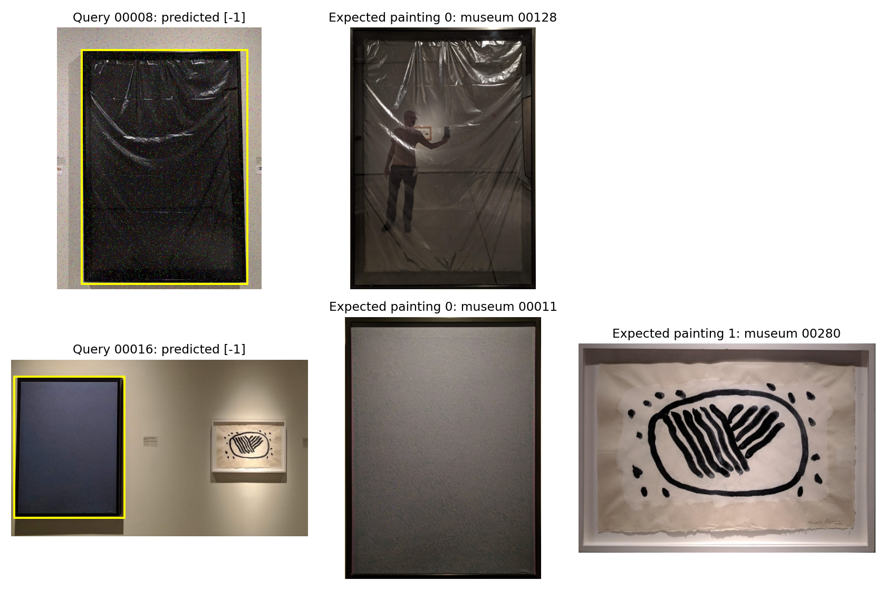

# C1-PROJECT

## Initial Setup

Create a virtual environment to encapsulate the required installations.

1. In your project directory, create the environment:
```powershell
   python -m venv .venv
```
2. Upgrade pip, in case the versions do not coincide:
```powershell
   .\.venv\Scripts\python.exe -m pip install --upgrade pip
```
3. Install the required packages:
```powershell
   .\.venv\Scripts\python.exe -m pip install -r requirements.txt
```
4. Activate the environment (Windows):
```powershell
   .\.venv\Scripts\Activate.ps1
```

> **Note:** Windows PowerShell may restrict running scripts by default. If activation fails, allow execution for the current session with:
> ```powershell
> Set-ExecutionPolicy -Scope Process -ExecutionPolicy Bypass
> ```

---

## Week 1

### Task 1: Image Descriptors

Run:
```powershell
python .\src\methods_w1.py --list
```

The W1 descriptors live in `methods_w1.py` (`METHODS_W1`), with the histogram
implementations in `utils.py`:
- Grayscale
- RGB
- HSV (one component per histogram)
- HSV grid (4×4 cells, 512 values)

### Task 2: Similarity Functions

All similarity formulas are implemented in `k_similarity.py`, and fall into two groups:

| Type | Functions | Interpretation |
|------|-----------|----------------|
| Distances | Euclidean, L1, Chi-square | Lower value = more similar |
| Similarities | Histogram Intersection, Hellinger kernel, Cosine, Correlation | Higher value = more similar |

### Task 3: Retrieval and Evaluation

Run:
```powershell
python .\src\k_similarity.py
```

This script retrieves the top K museum images for each query by comparing image descriptors (Grayscale, HSV, RGB, HSV grid) using the similarity functions.

**Ranking order**
- Distances are sorted in ascending order.
- Similarities (Histogram Intersection and Hellinger kernel) are sorted in descending order. They are listed in the `SIMILARITY_FUNCTIONS` constant, used by `rank_museum_images`.

Sorting a similarity in ascending order would return the least similar images first (scores of 0), which is why this distinction is needed.

**Evaluation metrics**
- **AP@K** measures how accurately the relevant museum images are ranked within the top K results for a single query, using the ground-truth correspondences.
- **mAP@K** averages AP@K across all queries, allowing retrieval performance to be compared across descriptor methods and distance functions for K=1 and K=5.

### Task 4: Blind QST1 submission

From the project directory, give the folders containing the museum and test images:
```bash
python .\src\methods_w2.py --museum .\data\BBDD --queries .\data\qsd1_w2 --method "Lab blocks 1D" --blocks 25 
```

Both arguments accept relative or absolute image-folder paths. Only JPG/JPEG
files directly inside each folder are read. Queries are ordered by numeric filename ID. Museum IDs come from
filenames: `bbdd_00007.jpg` becomes integer `7`.

Each `result.pkl` contains a Python list of lists, with exactly 10 unique Python
integer museum IDs per query, ranked best first.

| Output under `results/week1/QST1/` | Descriptor | Default comparison |
|---|---|---|
| `method1/result.pkl` | HSV | L1 |
| `method2/result.pkl` | HSV grid | L1 |

At most two methods are allowed (statement), so only HSV and HSV grid are
submitted; Grayscale and RGB remain in `METHODS_W1` for validation only.

To override the comparison for both methods or change the output location:
```bash
python src/methods_w1.py --museum data/BBDD --queries data/qst1_w1 --distance Hellinger --output-dir results/hellinger/week1/QST1
```

Available comparisons: `Euclidean`, `L1`, `Chi-square`, `Histogram Intersection`,
`Hellinger`, `Cosine`, and `Correlation`. Quote names containing spaces.

---

## Week 2

### Task 1: Color Histograms

`methods_w2.py` keeps four Lab descriptors (all L1-normalized, with an
optional foreground mask):

| Method | Description | Parameter |
|---|---|---|
| `Lab blocks 1D` | grid of marginal 1D histograms (32 bins per channel), concatenated in row-major order | `--blocks T` total cells, a perfect square (default 25 → 5×5) |
| `Lab 2D` | same grid of cells; each cell is L as a 1D marginal (32 bins) plus the (a, b) pair as a joint 2D histogram (32 bins per axis), concatenated row-major | `--blocks T` (default 25 → 5×5) |
| `Lab 3D` | same grid of cells; each cell is a joint 3D L-a-b histogram (32 bins per axis), concatenated row-major | `--blocks T` (default 25 → 5×5) |
| `Lab pyramid` | hierarchy of 1D-block levels: level 1 is one block, each extra level doubles the number of blocks (1, 2, 4, 8 …) | `--levels K` (default 3) |

Run `python .\src\methods_w2.py --list` to list them.

### Task 2: Retrieval Comparison

Run a W2 method on a museum/query pair (add `--ground-truth` to print mAP):
```powershell
python .\src\methods_w2.py --museum ..\..\datasets\BBDD --queries ..\..\datasets\qsd1_w2 --method "Lab blocks 1D" --blocks 25
```

`--method` is required: a descriptor name or `all` (evaluates the four methods
in one pass). Use `--blocks`/`--levels` for the parametrized methods and
`--distance` for the comparison (default L1).

For example, on QSD1-W2:
```powershell
python .\src\methods_w2.py --museum data\BBDD --queries data\qsd1_w2 --ground-truth data\qsd1_w2\qsd1_w1\gt_corresps.pkl --method all
```

mAP on the 30 QSD1-W2 queries against the BBDD (L1):

| Descriptor | Config | mAP@1 | mAP@5 |
|---|---|---:|---:|
| W1 HSV grid | 4×4 | 0.7667 | 0.8194 |
| W1 HSV grid | 6×6 | 0.8000 | 0.8500 |
| `Lab blocks 1D` | `--blocks 16` | 0.8333 | 0.8722 |
| `Lab blocks 1D` | `--blocks 25` (default) | 0.8667 | 0.8944 |
| `Lab blocks 1D` | `--blocks 36` | 0.8667 | 0.9000 |
| `Lab pyramid` | `--levels 3` | 0.6333 | 0.6744 |
| `Lab pyramid` | `--levels 4` | 0.7333 | 0.7778 |
| `Lab 2D` | `--blocks 1` (1×1) | 0.5333 | 0.6028 |
| `Lab 2D` | `--blocks 25` (default) | 0.8667 | 0.8917 |
| `Lab 3D` | `--blocks 1` (1×1) | 0.4000 | 0.4833 |
| `Lab 3D` | `--blocks 25` (default) | 0.7000 | 0.7472 |

`Lab blocks 1D --blocks 36` gives the best mAP@5 on this set (tied with the
default `--blocks 25` at rank 1). Evaluation with segmentation and blind
queries is still pending.

The extra experiments and their results are in
[results/week2/color_experiments](results/week2/color_experiments).

### Task 3: Background Removal

Method:
1. The outer 4% of the image is used as a sample of the wall.
2. A smooth color model of the wall is fitted in CIE-Lab (a polynomial surface,
   so uneven lighting is handled; frame corners or labels in the strip are
   down-weighted).
3. Each pixel's Mahalanobis distance to that wall model is computed; pixels far
   from the wall are foreground. The threshold is chosen per image (Otsu,
   clipped to 3-12).
4. Cleanup: morphology, keep the largest connected blob, fill holes, and replace
   the blob by its bounding box (paintings are rectangles). Use
   `BGParams(use_bbox=False)` for the pure color mask.

No edge, contour or object detector is used. Masks are saved with the same name
as the image and a `.png` extension (`00001.jpg` -> `00001.png`), values 0
(background) / 255 (painting). `--viz` saves one overlay per image plus
`overview.jpg` (dimmed = removed background, red = our mask, green =
ground truth, F1 on every tile). If the ground-truth masks sit next to the
images (QSD2), the mean P/R/F1 is printed.

### Task 4: Segmentation Evaluation

Run after generating the masks from Task 3:
```powershell
python src\methods_w2.py --segment data\qsd2_w2 --out results\week2\QSD2\masks --viz results\week2\QSD2\viz 
```

The script matches PNG masks by numeric filename ID and computes foreground
precision, recall and F1 for each query. Masks must have the same dimensions
as their reference, with 0 for background and nonzero pixels for foreground.

The table shows the scores for each query and their mean. Use `--save` to
write it to a text file.

Add `--viz` to also draw the masks over the images (`--images` if the `.jpg`
files are not in the ground-truth folder):
```powershell
python src\methods_w2.py --segmentation results\week2\QSD2\masks data\qsd2_w2 --viz results\week2\QSD2\viz --save results\week2\QSD2\mask_metrics.txt
```

Result of Task 3 on the 30 QSD2 images:

| | Precision | Recall | F1 |
|---|---:|---:|---:|
| Mean over the 30 images | 0.9370 | 0.9827 | **0.9569** |

19 of 30 masks have F1 >= 0.95. The weakest are 00020 (white painting on a
light wall, 0.84), 00026, 00014, 00000 and 00013. Most of the lost precision is
the shadow or lighter strip of wall just below a painting.

### Task 5: Retrieval on QSD2 with Background Removal

Add `--background-removal` to the retrieval command: each query is segmented
with Task 3 and the descriptor only counts the painting pixels.
```powershell
python src\methods_w2.py --museum data\BBDD --queries data\qsd2_w2 --ground-truth data\qsd2_w2\qsd2_w1\gt_corresps.pkl --method "Lab pyramid" --levels 7 --background-removal
```

Museum images contain only the painting, but a query has wall around it. The
block grid is laid over the image, so cell (i, j) of the query would cover a
different part of the painting than cell (i, j) of the museum image, even when
the wall pixels are masked out. The query is therefore **cropped to the
bounding box of its mask** before the descriptor is computed. `--no-crop` turns
this off.

mAP@1 / mAP@5 on QSD2 (L1):

| Descriptor | **Mask + crop** | Ground-truth mask + crop |
|---|---:|---:|
| `Lab pyramid --levels 7` | **0.8333 / 0.8483** | 0.8667 / 0.8750 |
| `Lab blocks 1D --blocks 36` | 0.7667 / 0.8139 | 0.8667 / 0.8844 |
| `Lab blocks 1D --blocks 16` | 0.7000 / 0.7556 | 0.7333 / 0.7890 |

The last column uses the ground-truth masks (`--query-masks data\qsd2_w1`) and is
a comparison with the annotated masks. `--background-removal` and
`--query-masks` cannot be used together.

### Task 6: Blind Submission (QST1 and QST2)

```powershell
python src\methods_w2.py --museum data\BBDD --qst1 data\qst_w2\qst1_w2 --qst2 data\qst_w2\qst2_w2
```

Give `--qst1` and/or `--qst2` (the folders must contain the `.jpg` files
directly). Use `--submit-out` to change the output folder (default
`results/week2`) and `--distance` to change the comparison.

| Output under `results/week2/` | Content |
|---|---|
| `QST1/method1/result.pkl` | `Lab blocks 1D`, 6x6 cells (`--blocks 36`), L1, whole image |
| `QST1/method2/result.pkl` | `Lab pyramid`, 7 levels (`--levels 7`), L1, whole image |
| `QST2/method1/result.pkl`, `QST2/method2/result.pkl` | same methods on the painting only (Task 3 mask + crop) |
| `QST2/method1/*.png`, `QST2/method2/*.png` | background masks, same name as the query, 0/255 |

Each `result.pkl` is a Python list of lists with exactly 10 unique integer
museum IDs per query, best first. After writing, the script reads every file
back and checks the IDs, and that each mask exists, has the size of its query
and contains only 0 and 255. The methods are defined in `SUBMISSION_METHODS`
in `methods_w2.py`.

---

## Week 3

The development sets are in `data/qsd1_w3` (30 cropped queries, one painting each)
and `data/qsd2_w3` (30 queries with up to two paintings). Both contain noise and
hue changes. Use the JPG files in these folders; `non_augmented/` contains the
clean reference copies and is not used as query input.

| File | Content |
|---|---|
| `methods_w3.py` | Task 1: query filters (Median, Open, Close, Open+Close, Close+Open, Average, Gaussian, Low-pass Wavelet), the filter sweep, and the HSV hue-invariance mode |
| `paintings_w3.py` | Task 2: texture descriptors (LBP, Multiscale LBP, DCT, Wavelet, and the improved DCT log and Texture fusion); Tasks 3, 4 and 5: multi-painting segmentation, retrieval per painting, blind submission |

`paintings_w3.py` reuses the W2 wall model, ranking, mask evaluation and
overlays. The texture descriptors are the first part of the same file, so
`paintings_w3.py` is self-contained apart from the W2 modules and the Task 1
filter, which it imports from `methods_w3.py` through `--query-filter`.

### Task 1: Noise Filtering

`methods_w3.py` registers one `Lab blocks 1D <filter>` method per filter
(Median, Open, Close, Open+Close, Close+Open, Average, Gaussian, Low-pass
Wavelet) plus the unfiltered `Lab blocks 1D` baseline. All of them use the W2
descriptor (CIE-Lab, 32 bins per channel, 5x5 = 25 cells, L1-normalized) with
the L1 distance, so only the preprocessing changes between methods.

Common options:

| Option | Meaning |
|---|---|
| `--kernel K` | Odd spatial size (>= 3) shared by every filter. **Required**, with no default, so every reported number states its kernel. The wavelet filter uses `--wavelet-level` instead |
| `--filter-scope both` | (default) the filter is applied to the queries **and** the museum images, so both sides share the same filtered domain. `query` filters the queries only |
| `--hue-invariant` | HSV hue-invariance mode: a global hue scale is estimated per (query, museum image) pair and the raw Lab distance is blended with the hue-normalized one. Needs `color_reference` |
| `--hue-reference FILE.npz` | Cache for the museum hue histograms. If the file exists it is **loaded, not rebuilt**, so use one file per filter and kernel |
| `--hue-alpha`, `--hue-temperature` | Blend weight and confidence temperature of the hue correction (default 1.0 each) |

Without `--hue-invariant` the script prints a warning: those numbers do not
include the hue correction and cannot be compared with hue-invariant ones.

**Single-pass comparison at one kernel size.** All methods with the same
kernel (hue-invariance is not available with `--method all`):

```powershell
python src/methods_w3.py --museum data/BBDD --queries data/qsd1_w3 --method all --kernel 5 --ground-truth data/qsd1_w3/gt_corresps.pkl
```

| Method (kernel 5x5) | mAP@1 | mAP@5 |
|---|---:|---:|
| `Lab blocks 1D` (no filter) | 0.6667 | 0.7511 |
| Median | 0.7333 | 0.7944 |
| Average | 0.7333 | 0.7889 |
| Gaussian | 0.7333 | 0.7889 |
| Open | 0.7333 | 0.7806 |
| Close | 0.7000 | 0.7622 |
| Open+Close | 0.7333 | 0.7861 |
| Close+Open | 0.7000 | 0.7789 |

**Kernel search per filter.** The sweep tries every filter over a grid of
sizes (`--kernel` is still required by the parser but the sweep uses its own
grids):

```powershell
python src/methods_w3.py --museum data/BBDD --queries data/qsd1_w3 --sweep --kernel 3 --ground-truth data/qsd1_w3/gt_corresps.pkl
```

Best kernel per filter on QSD1-W3 (`Lab blocks 1D`, L1, 30 queries,
`--filter-scope both`, no hue-invariance):

| Filter | Best kernel | mAP@1 | mAP@5 |
|---|---:|---:|---:|
| none (baseline) | - | 0.6667 | 0.7511 |
| **Median** | **7x7** | **0.7667** | **0.8178** |
| Median (best mAP@5) | 15x15 / 17x17 | 0.7667 | 0.8233 |
| Open+Close | 7x7 | 0.7667 | 0.8028 |
| Average | 9x9 / 11x11 | 0.7333 | 0.7983 |
| Gaussian | 9x9 to 15x15 | 0.7333 | 0.7956 |
| Low-pass Wavelet | level 3 | 0.7333 | 0.7956 |
| Open | 5x5 | 0.7333 | 0.7806 |
| Close+Open | 3x3 | 0.7000 | 0.7722 |
| Close | 3x3 | 0.7000 | 0.7667 |

This table was run **without** `--hue-invariant`. Every filter improves on the
unfiltered baseline (0.7511 mAP@5). Without hue correction the median filter
is the best one: its mAP@5 is flat from 7x7 to 21x21 (0.8122-0.8233), so the
result does not depend on a lucky kernel size. Open+Close is the best
morphological filter (7x7), 0.015 mAP@5 below the median. The final system
uses hue-invariance, so the filters are ranked again with it below.

**Hue-invariance.** The hue correction is added on top of a filter. Use one
cache file per filter and kernel (a stale cache from another filter gives wrong
numbers):

```powershell
python src/methods_w3.py --museum data/BBDD --queries data/qsd1_w3 --method "Lab blocks 1D open+close" --kernel 7 --filter-scope both --hue-invariant --hue-reference results/week3/hue_openclose7.npz --ground-truth data/qsd1_w3/gt_corresps.pkl
python src/methods_w3.py --museum data/BBDD --queries data/qsd1_w3 --method "Lab blocks 1D wavelet" --kernel 7 --wavelet-level 3 --filter-scope both --hue-invariant --hue-reference results/week3/hue_wavelet3.npz --ground-truth data/qsd1_w3/gt_corresps.pkl
```

(`--kernel` is required by the parser but the wavelet filter ignores it and
uses `--wavelet-level`.)

Best kernel per filter on QSD1-W3 with hue-invariance (`--hue-invariant`,
`Lab blocks 1D`, L1, 30 queries, `--filter-scope both`):

| Filter | Best setting | mAP@1 | mAP@5 |
|---|---:|---:|---:|
| none (baseline) | - | 0.7333 | 0.7694 |
| Median | 7x7 | 0.8000 | 0.8317 |
| Open | 9x9 | 0.7667 | 0.8000 |
| Close | 7x7 | 0.7333 | 0.7928 |
| Open+Close | 7x7 | 0.8000 | 0.8278 |
| Close+Open | 7x7 | 0.7667 | 0.8167 |
| Average | 5x5 | 0.8000 | 0.8317 |
| Gaussian | 7x7 | 0.8000 | 0.8317 |
| **Low-pass Wavelet** | **level 3** | **0.8000** | **0.8344** |

Hue-invariance adds 0.067 mAP@1 and 0.0183 mAP@5 to the unfiltered baseline
(0.6667 / 0.7511 without it), and it raises every filter: for example
Open+Close 7x7 goes from 0.7667 / 0.8028 to 0.8000 / 0.8278. Low-pass Wavelet
is the best filter overall, but the margin is small: the median, average and
Gaussian filters are 0.0027 mAP@5 behind it and Open+Close 0.0066, which on 30
queries is at most one query moving one rank. All of them reach mAP@1 0.8000,
so they cannot be told apart at rank 1. The morphological filters Open, Close
and Close+Open are the weakest.

An earlier Open+Close 11x11 run with hue-invariance (0.7333 / 0.7861) is
identical to the no-hue 5x5 result, so it is not used; 7x7 is the best size
for Open+Close in the sweep.

**Why the other filters are kept.** Low-pass Wavelet is the best filter of
this comparison, but all filters stay registered and selectable (`--method`,
`--sweep`) instead of fixing the wavelet for the rest of the project. The
reasons are the following hypotheses:

1. **The result is specific to one system and one set.** The ranking was
   measured for the Lab colour histogram with hue-invariance on the 30 queries
   of QSD1-W3. The margins are small: the wavelet (0.8344) is 0.0027 mAP@5
   above the median, average and Gaussian filters (0.8317) and 0.0066 above
   Open+Close 7x7 (0.8278), with the same mAP@1 (0.8000) for all of them. On 30
   queries these filters are practically tied, so the winner may change with
   another set of queries.
2. **Other descriptors may depend on different image information.** A colour
   histogram with 32 bins per channel uses coarse intensity distributions, so
   it should tolerate a filter that removes fine detail. Texture descriptors
   such as LBP, DCT or wavelet energies are computed from local pixel
   differences and high-frequency content, which a low-pass filter removes. A
   filter that is best for colour is therefore not guaranteed to be best for
   texture, and keeping the alternatives allows to check it for each
   descriptor.
3. **The noise model is unknown and only some queries are noisy.** The task
   does not describe the noise, and the test queries may contain different
   noise from the development ones. A median filter is a robust option for
   isolated outlier pixels and preserves edges, so it is kept as a fallback
   to a filter that was tuned on 30 images.
4. **A common set of filters makes the comparison reproducible.** With every
   filter available under the same interface (`--kernel`, `--wavelet-level`,
   `--filter-scope`), the selection can be repeated for any later descriptor
   or development set, instead of assuming that the winner of one experiment
   transfers to the next.

The texture descriptors of Task 2 use only the grayscale image, so the
HSV hue-invariance step is not used for them. Grayscale conversion alone does
not guarantee invariance to hue changes.

### Task 2: Texture Descriptors

All descriptors extract texture features from the grayscale image rather than
explicit color histograms. Hue changes can still change the converted gray
levels. The image is split into 5x5 = 25 blocks and the block features are
concatenated, which keeps the position of the texture.

| Method | Description | Size |
|---|---|---:|
| `LBP` | 3x3 Local Binary Pattern, 256-bin histogram per block | 6400 |
| `LBP uniform` | same codes, 58 uniform patterns plus one bin for the rest | 1475 |
| `Multiscale LBP` | circular LBP at (P,R) = (8,1), (12,2.5), (16,4), bilinear interpolation, uniform patterns, three histograms per block | 10925 |
| `DCT` | 2D DCT per block, zig-zag scan, first 15 coefficients without the DC term | 375 |
| `Wavelet` | 3-level Haar; mean absolute value of each detail subband per block | 225 |
| `DCT log` | DCT with log-compressed coefficients, sign(c)*log(1+abs(c)) | 375 |
| `Texture fusion` | `DCT log`, square-root `Multiscale LBP` and square-root `Wavelet`, each scaled to unit L2 norm and concatenated | 11525 |

Evaluation on QSD1-W3 with texture only: no segmentation (the queries are
already cropped), no color. `--table` prints a method x distance table (mAP@1
and mAP@10, 30 queries). It is run without a filter and with several Task 1
filters on the queries (the museum images are not filtered). `--denoise N` is a
median filter; any other Task 1 filter is selected with `--filter NAME
--kernel K` (the wavelet needs no kernel).

```powershell
python src/paintings_w3.py --museum data/BBDD --queries data/qsd1_w3 --ground-truth data/qsd1_w3/gt_corresps.pkl --table --method all --distance all
python src/paintings_w3.py --museum data/BBDD --queries data/qsd1_w3 --ground-truth data/qsd1_w3/gt_corresps.pkl --table --method all --distance all --denoise 3
python src/paintings_w3.py --museum data/BBDD --queries data/qsd1_w3 --ground-truth data/qsd1_w3/gt_corresps.pkl --table --method all --distance all --denoise 5
python src/paintings_w3.py --museum data/BBDD --queries data/qsd1_w3 --ground-truth data/qsd1_w3/gt_corresps.pkl --table --method all --distance all --filter average --kernel 5
python src/paintings_w3.py --museum data/BBDD --queries data/qsd1_w3 --ground-truth data/qsd1_w3/gt_corresps.pkl --table --method all --distance all --filter gaussian --kernel 7
python src/paintings_w3.py --museum data/BBDD --queries data/qsd1_w3 --ground-truth data/qsd1_w3/gt_corresps.pkl --table --method all --distance all --filter wavelet_lowpass
python src/paintings_w3.py --museum data/BBDD --queries data/qsd1_w3 --ground-truth data/qsd1_w3/gt_corresps.pkl --table --method all --distance all --filter open+close --kernel 7
```

mAP@1, best distance per descriptor and filter:

| Descriptor | No filter | Median 3x3 | Median 5x5 | Average 5x5 | Gaussian 7x7 | Wavelet L3 | Open+Close 7x7 |
|---|---:|---:|---:|---:|---:|---:|---:|
| `LBP` | 0.800 | 0.600 | 0.533 | 0.500 | 0.500 | 0.300 | 0.233 |
| `LBP uniform` | 0.667 | 0.600 | 0.533 | 0.467 | 0.467 | 0.300 | 0.233 |
| `Multiscale LBP` | 0.900 | 0.967 | 0.967 | 0.933 | 0.933 | 0.533 | 0.367 |
| `DCT` | 0.967 | 0.967 | 0.967 | 0.967 | 0.967 | 0.967 | 0.933 |
| `Wavelet` | 0.833 | 0.867 | 0.867 | 0.833 | 0.867 | 0.633 | 0.633 |
| `DCT log` | **1.000** | **1.000** | **1.000** | **1.000** | **1.000** | **1.000** | 0.967 |
| `Texture fusion` | **1.000** | **1.000** | **1.000** | **1.000** | **1.000** | **1.000** | **1.000** (L1: 0.967) |

Best distances: `DCT` and `DCT log` work with L1, Cosine and Correlation;
`Texture fusion` with L1, Euclidean, Cosine and Correlation (with Open+Close,
L1 drops to 0.967 and the other three keep 1.000); Multiscale LBP with
Hellinger or Chi-square after most filters; Wavelet with L1 or Histogram
Intersection. Euclidean and Cosine are poor for Multiscale LBP.

Observations:

- **`DCT log` and `Texture fusion` are the most robust.** They find the right
  painting at rank 1 for all 30 queries with no filter and with the median,
  average, Gaussian and wavelet filters; only Open+Close 7x7 lowers `DCT log`
  to 0.967. These results show robust retrieval on the noisy, hue-modified
  QSD1-W3 queries; plain `DCT` is also stable (0.933-0.967). A likely reason is
  that the DCT parts keep only the first 15 zig-zag coefficients of each block,
  which are low frequencies, and the filters mostly change the high frequencies.
  The fusion inherits this stability from its `DCT log` part.
- **The LBP histograms get worse as the smoothing gets stronger.** Plain LBP
  goes from 0.800 (no filter) to 0.600 (median), 0.500 (average, Gaussian),
  0.300 (wavelet) and 0.233 (Open+Close). The code of a pixel depends on the
  sign of its differences with the neighbours, so a filtered query has other
  codes than the unfiltered museum image it should match. The strongest
  filters (wavelet, Open+Close) remove most of the local variation, and this
  gives the largest drop.
- **Multiscale LBP and the Haar `Wavelet` descriptor benefit from mild
  filters and fail with strong ones.** Multiscale LBP rises from 0.900 to
  0.967 with the median and 0.933 with the average and Gaussian filters, but
  falls to 0.533 (wavelet) and 0.367 (Open+Close). `Wavelet` goes from 0.833
  to 0.867 with the median and Gaussian filters and falls to 0.633 with the
  wavelet and Open+Close. Both use larger neighbourhoods or subband energies,
  so removing isolated noise pixels helps them, but removing the real fine
  texture does not.
- **The filter has to be tuned to the descriptor.** The same filter can
  improve one descriptor and damage another, so the table is read per column
  and not only per row.

#### Texture fusion (final descriptor)

`Texture fusion` is the descriptor submitted for Tasks 4 and 5. It joins three
texture descriptors that look at the image in different ways, using only the
grayscale image (no color):

| Part | What it captures | How it is computed | Size |
|---|---|---|---:|
| `DCT log` | Frequency content of each block (coarse to fine texture) | gray image resized to 255x255, 25 blocks of 51x51; 2D DCT per block; zig-zag scan; the DC term (mean brightness) is dropped and the next 15 coefficients are kept; each coefficient c becomes sign(c)*log(1+abs(c)) | 375 |
| Multiscale LBP | Local micro-patterns (edges, spots, flat areas) at three scales | gray image with the longest side at 256 px; circular LBP at (P,R) = (8,1), (12,2.5), (16,4); uniform patterns; one histogram per block and scale; L1 normalization; square root | 10925 |
| Wavelet | Oriented detail energy at three scales | gray image resized to 256x256; 3-level Haar; mean absolute value of the horizontal, vertical and diagonal details in each block; L1 normalization; square root | 225 |

The final vector is `[DCT log / ||DCT log||, MLBP / ||MLBP||, Wavelet / ||Wavelet||]`:
every part is divided by its own L2 norm and the three are concatenated with
the same weight (11525 values). No weight was tuned.

Why each step is there:

- **DCT without the DC term.** The DC coefficient is the mean brightness of
  the block, which is not texture and changes with lighting. Skipping it makes
  the descriptor insensitive to brightness shifts.
- **Log on the DCT coefficients.** The low-frequency coefficients are much
  larger than the others, so in a plain L1 or Euclidean distance they dominate
  and the fine texture is ignored. The log compresses that range, so every
  coefficient counts, and it also reduces the effect of noise and contrast
  changes. This step alone moves `DCT` from 0.7436 to 0.7692 on QSD2-W3.
- **Square root on the histograms.** LBP and wavelet values are L1-normalized
  histograms. After a square root, the Euclidean distance between two vectors is
  the Hellinger distance between the histograms, which is a better measure for
  histograms and reduces the weight of very frequent patterns.
- **Unit L2 norm per part.** The three parts have very different sizes (375,
  10925, 225 values) and scales. Without this step the long LBP part would
  dominate the distance; with it, each part contributes comparably.
- **Grayscale only.** No explicit color descriptor is used, although hue changes
  can still affect the gray levels. LBP is invariant to strictly increasing
  transformations of the gray levels.

Why the fusion works: the three parts are complementary. The DCT describes
global frequency content per block, LBP describes the local structure of the
pixels, and the wavelet describes how much detail there is and in which
direction. A painting that is ambiguous for one of them is usually
separated by another. This is visible in the results: on QSD2-W3 the best single
descriptor reaches mAP@1 0.7692, while the fusion reaches 0.9231 (+0.154, 3x3
median run), and on QSD1-W3 it finds all 30 paintings at rank 1.

The default distance is L1; on QSD1-W3 the fusion gives 1.000 with L1,
Euclidean, Cosine and Correlation, so it does not depend on one distance.
Because the vector contains signed DCT values, Chi-square, Histogram
Intersection and Hellinger are not valid for it. The cost is a longer vector
(11525 values) and a slower descriptor computation than a single descriptor,
which is acceptable for 287 museum images and 30 to 50 queries.

### Task 3: Background Removal for Multiple Paintings

```powershell
python src/paintings_w3.py --segment data/qsd2_w3 --out results/week3/QSD2/masks --viz results/week3/QSD2/viz
```

The method follows the W2 Lab wall model and Mahalanobis distance. The wall
is sampled from the outer 2% of the image. Closing connects thin frame edges
before opening removes small speckles. Instead of keeping only the largest
component, up to two components are kept, each above 2% of the image area.
Overlapping boxes are merged and each painting gets its own bounding box.
The mask is the union of these boxes, with the wall between them left out.

Masks keep the query name and original dimensions, with 0 for background and
255 for foreground. `segmentation.json` records crop boxes and per-image
metrics. The overlays use the W2 convention: red prediction, green ground
truth. Evaluate saved masks with the same W2 metrics:

```powershell
python src/paintings_w3.py --segmentation results/week3/QSD2/masks data/qsd2_w3 --save results/week3/QSD2/mask_metrics.txt
```

To evaluate several method outputs stored below one directory (for example
`all_methods/dct`, `all_methods/lbp`, and `all_methods/wavelet`), pass the
parent directory. The saved report contains one labeled section per method:

```powershell
python src/paintings_w3.py --segmentation results/week3/QSD2/all_methods data/qsd2_w3 --save results/week3/QSD2/mask_metrics_all.txt
```

Results on the 30 augmented QSD2-W3 queries (segmentation does not depend on
the query filter or on the descriptor):

| Method | Precision | Recall | F1 | Correct painting count |
|---|---:|---:|---:|---:|
| W2, largest component only | 0.9631 | 0.7330 | 0.8076 | 21/30 |
| W3, two components, W2 4% border | 0.9622 | 0.9227 | 0.9348 | 29/30 |
| W3, two components, 2% border | 0.9577 | 0.9573 | **0.9526** | **29/30** |

The border width was selected on this development set. The comparison is
saved in `results/week3/QSD2/segmentation_comparison.csv`. Query 00002 still
loses the smaller painting; 00010 loses the dark lower part of the painting.

### Task 4: Retrieval per Painting

Final command: `Texture fusion`, L1, queries filtered with a 3x3 median
filter (Task 1 filter, chosen on QSD2-W3):

```powershell
python src/paintings_w3.py --museum data/BBDD --queries data/qsd2_w3 --background-removal --ground-truth data/qsd2_w3/gt_corresps.pkl --method "Texture fusion" --distance L1 --filter median --kernel 3 --top-k 10 --output-dir results/week3/QSD2/texture_fusion
```

Each painting is cropped separately, then compared with the museum images.
Paintings in the same row are ordered left to right; vertically separated
paintings are ordered top to bottom. Queries follow numeric filename order.
If segmentation finds nothing, retrieval uses the full image and records
the fallback; the saved segmentation mask remains empty.

The default method is `Texture fusion` with the L1 distance. Choose another one
with `--method NAME` (`--method all` runs every texture method, saving each one
in its own subfolder) and `--distance NAME`.

Query filter options (applied to every painting crop before its descriptor):

| Option | Meaning |
|---|---|
| `--filter NAME` | Any Task 1 filter: `median`, `open`, `close`, `open+close`, `close+open`, `average`, `gaussian`, `wavelet_lowpass`, or `none`. Without this option retrieval uses `wavelet_lowpass` (level 3); `--table` uses `none` |
| `--kernel K` | Odd kernel size of the spatial filters (required for them) |
| `--wavelet`, `--wavelet-level` | Family and level of `wavelet_lowpass` (default `db2`, 3); no kernel is needed |
| `--filter-scope {query,both}` | Filter only the query crops (default) or the museum images too |
| `--query-filter module:function` | Custom `fn(rgb) -> rgb`, instead of `--filter` |

The wavelet filter needs the `PyWavelets` package. The filter name and scope
are saved in `retrieval.json`.

#### Effect of the Task 1 filter on the texture pipeline

`Texture fusion`, L1, QSD2-W3, predicted crops (30 queries, 39 paintings). The
segmentation is the same in every run (F1 0.9526, painting count correct in
29/30), so the differences come only from the filter:

| Query filter | Scope | mAP@1 | mAP@5 | mAP@10 |
|---|---|---:|---:|---:|
| none | - | 0.7949 | 0.8192 | 0.8192 |
| **Median 3x3** | query | **0.9231** | **0.9231** | **0.9231** |
| Low-pass Wavelet (level 3) | both | 0.8462 | 0.8739 | 0.8739 |
| Open+Close 7x7 | query | 0.7436 | 0.7607 | 0.7675 |

```powershell
python src/paintings_w3.py --museum data/BBDD --queries data/qsd2_w3 --background-removal --ground-truth data/qsd2_w3/gt_corresps.pkl --method "Texture fusion" --distance L1 --top-k 10 --filter none --output-dir results/week3/QSD2/tests/none
python src/paintings_w3.py --museum data/BBDD --queries data/qsd2_w3 --background-removal --ground-truth data/qsd2_w3/gt_corresps.pkl --method "Texture fusion" --distance L1 --top-k 10 --filter median --kernel 3 --output-dir results/week3/QSD2/tests/median3
python src/paintings_w3.py --museum data/BBDD --queries data/qsd2_w3 --background-removal --ground-truth data/qsd2_w3/gt_corresps.pkl --method "Texture fusion" --distance L1 --top-k 10 --filter wavelet_lowpass --filter-scope both --output-dir results/week3/QSD2/tests/wavelet_both
python src/paintings_w3.py --museum data/BBDD --queries data/qsd2_w3 --background-removal --ground-truth data/qsd2_w3/gt_corresps.pkl --method "Texture fusion" --distance L1 --top-k 10 --filter open+close --kernel 7 --output-dir results/week3/QSD2/tests/openclose7
```

Per descriptor, L1, 3x3 median on the queries (`--method all`):

| Descriptor | mAP@1 | mAP@5 | mAP@10 |
|---|---:|---:|---:|
| W2 Lab pyramid, 7 levels (baseline, no filter) | 0.7436 | 0.7564 | - |
| `LBP uniform` | 0.5128 | 0.5650 | 0.5723 |
| `LBP` | 0.6154 | 0.6603 | 0.6639 |
| `Wavelet` | 0.6923 | 0.7205 | 0.7248 |
| `Multiscale LBP` | 0.7179 | 0.7231 | 0.7231 |
| `DCT` | 0.7436 | 0.7436 | 0.7436 |
| `DCT log` | 0.7692 | 0.8085 | 0.8085 |
| **`Texture fusion`** | **0.9231** | **0.9231** | **0.9231** |

Without a filter, the first run gave `LBP` 0.6154, `LBP uniform`
0.5641, `Multiscale LBP` 0.6410, `DCT` 0.7436 and `Wavelet` 0.6923 (mAP@1). The
median filter helps Multiscale LBP (+0.077) and lowers LBP uniform (-0.051).
With the median filter, `Texture fusion` is 0.154 above `DCT log`, the best single
descriptor (mAP@1: 0.9231 vs. 0.7692). Of the 39 paintings, 36 are correct at
rank 1; the missing ones come from the image with a wrong painting count and
from weak masks, so segmentation is now the main limit.

#### Discussion: why the filter matters, and why the median wins

1. **The noise corrupts the texture descriptors.** The noisy queries have
   isolated, randomly coloured pixels (see the QSD1-W3 examples). LBP compares
   every pixel with its neighbours, so one wrong pixel changes the code of
   itself and of its eight neighbours; the DCT and the wavelet details pick up
   the same pixels as spurious high-frequency energy. The museum images do not
   have this noise, so the unfiltered query and its museum image look like
   different textures. This is why `Texture fusion` reaches only 0.7949 without
   a filter.
2. **The median removes this noise and keeps the texture.** An isolated outlier
   is never the median of its 3x3 neighbourhood, so it is replaced by a value
   from the surrounding painting, while edges and strokes wider than two pixels
   survive. This brings the query back close to its clean museum image, which
   explains the gain of +0.128 mAP@1 (0.7949 to 0.9231). The small kernel
   matters: the texture descriptors work on fine detail, so a filter that
   changes more than the outlier pixels also changes the signal that is being
   matched.
3. **The low-pass wavelet helps, but less (0.8462).** It removes the noise
   because it zeroes every detail coefficient of the first three levels, but it
   zeroes the genuine fine texture too, which the LBP, wavelet and high-order
   DCT parts of the fusion need. It was applied to both queries and museum, so
   the two sides are blurred in the same way and remain comparable, which is
   probably why it still beats no filter; but the information that was
   removed cannot be recovered, so it stays below the median.
4. **Open+Close 7x7 hurts (0.7436, below no filter).** Opening and closing
   with a 7x7 element flatten every bright or dark structure smaller than the
   element, and this includes the small strokes and grain that make up the
   texture. In flat areas, the LBP comparison (neighbour >= centre) gives the
   same code everywhere, so the histograms change a lot. As this filter was
   applied to the queries only, the query is now much smoother than the sharp
   museum image it should match, and the mismatch is bigger than the noise it
   removed.
5. **The best filter for colour is not the best for texture.** In Task 1 the
   Lab colour histogram (32 bins per channel, hue-invariant) preferred the
   low-pass wavelet and Open+Close 7x7, since colour histograms depend on
   coarse intensity distributions and are barely affected by losing fine
   detail. The texture descriptors depend on exactly that fine detail, so the
   ranking reverses: median > wavelet > none > Open+Close. A filter must be
   selected for the descriptor that it feeds, and this is why Task 4 repeats the
   comparison.
6. **The remaining error is segmentation.** All runs share the same masks. With
   the median filter, the 3 wrong paintings out of 39 come from the image with
   a wrong painting count and from weak masks, so a better descriptor or filter
   would not change much. `mAP@1 = mAP@5` shows that when the painting is
   found, it is already at rank 1.

Limits of this comparison: the four runs differ in the filter **and** in the
scope (the wavelet was applied to queries and museum, the others to the queries
only), and each filter was tested with one kernel size. The explanations above
fit the results, but they were not isolated by separate experiments. To
isolate them, run the median with `--filter-scope both`, the wavelet with
`--filter-scope query`, and the median with `--kernel 5` and `7`.

Evaluation computes AP separately for each painting in annotation order.
Missing or extra paintings contribute zero; the mean is taken over painting
slots, so an image with two paintings contributes two scores. Count accuracy
is reported separately. These results use the development correspondences.

`retrieve_folder_w3` accepts a `descriptor(rgb)` callable, shared by museum
images and query crops, and an optional `query_filter(rgb)` applied to the
queries (and to the museum images with `filter_scope="both"`). The CLI builds
the filter from `--filter`/`--kernel`, or loads `--descriptor module:function`
and `--query-filter module:function`, for example
`--descriptor paintings_w3:dct_log_descriptor`.

Outputs in the chosen folder:

| File | Content |
|---|---|
| `result.pkl` | query -> painting -> 10 ranked integer museum IDs |
| `*.png`, `segmentation.json` | masks and crop boxes when using background removal |
| `retrieval.json` | rankings, configuration (including the filter name and scope), fallbacks and evaluation metrics |

Even a query with one painting has the extra list level: `[[[7, 25, ...]],
[[44, 81, ...], [3, 9, ...]], ...]`. The result file is read back and checked
for list sizes, unique IDs and Python integers.

### Task 5: Blind Submission (QST1 and QST2)

Only the best method is submitted, one per test set: `Texture fusion`, L1,
3x3 median filter on the queries, top 10. Every `result.pkl` has the extra list
level (a list of one or two painting rankings per query).

QST1-W3 has cropped pictures with one painting, so segmentation is not used and
the whole image is the painting. QST2-W3 has pictures with background and up to
two paintings, so segmentation is used and the masks are submitted.

```powershell
python src/paintings_w3.py --museum data/BBDD --queries data/qst1_w3 --method "Texture fusion" --distance L1 --filter median --kernel 3 --top-k 10 --output-dir results/week3/QST1/method1
python src/paintings_w3.py --museum data/BBDD --queries data/qst2_w3 --background-removal --method "Texture fusion" --distance L1 --filter median --kernel 3 --top-k 10 --output-dir results/week3/QST2/method1
```

| Output | Content |
|---|---|
| `Team1/week3/QST1/method1/result.pkl` | 50 queries, one painting ranking each |
| `Team1/week3/QST2/method1/result.pkl` | 30 queries, one or two painting rankings each |
| `Team1/week3/QST2/method1/*.png` | background masks, same name as the query, 0/255 |

Only these files are delivered; `segmentation.json` and `retrieval.json` in the
same folders are for our own records.

---

## Week 4

QSD1-W4 contains 30 queries and 39 paintings: 29 belong to the museum and
10 are unknown (`-1`). We use the JPG files directly in `data/qsd1_w4`,
not the clean copies in `non_augmented/`. Museum images are in `data/BBDD`.

### Tasks 1 and 2: SIFT and Matching

`keypoints_w4.py` extracts SIFT descriptors from grayscale images, with
`nfeatures=1000`. `extract_features_w4.py` processes the museum and each
detected query crop, saving descriptors, keypoint coordinates and crop boxes.
Query segmentation reuses the W3 wall model with a fixed distance threshold
of 4. The original adaptive threshold and fixed thresholds 3, 4, 5 and 6 were
compared on QSD1-W4:

| Segmentation | Mask precision | Mask recall | Mask F1 | Correct painting count |
|---|---:|---:|---:|---:|
| W3 adaptive | 0.9036 | 0.8020 | 0.8358 | 25/30 |
| Fixed threshold 3 | 0.8724 | 0.9630 | 0.9140 | 27/30 |
| **Fixed threshold 4** | **0.9103** | **0.9424** | **0.9244** | **28/30** |
| Fixed threshold 5 | 0.9267 | 0.8961 | 0.9050 | 26/30 |
| Fixed threshold 6 | 0.8991 | 0.7786 | 0.8099 | 22/30 |

Threshold 4 gives the best mask F1 and painting count among these settings.
If no painting is found, the whole image is used as a fallback. This happens
on query 00026. A fallback is still a prediction, so retrieval count accuracy
can differ from the segmentation count in this table.

```bash
python src/extract_features_w4.py --museum data/BBDD --output results/week4/sift/museum
python src/extract_features_w4.py --queries data/qsd1_w4 --segmentation-threshold 4 --output results/week4/sift/qsd1_w4_threshold4
```

`matching_w4.py` compares SIFT vectors with L2 distance and a nearest-neighbour
ratio test of 0.75. A museum descriptor can be matched only once. Pairs with
at least 8 tentative matches are checked with a RANSAC homography. Coordinates
are scaled to a reference longest side of 1000 pixels, with a RANSAC tolerance
of 5. Museum candidates are ranked by verified matches, then tentative matches,
then museum ID to break ties.

`batch_matching_w4.py` runs this over all crops. It also selects an unknown
rejection threshold by maximizing unknown-positive F1 on the development set.
Every threshold that changes a prediction is considered; equal-F1 ties use
the smaller threshold. Prediction uses this saved calibration without reading GT.

We also compared L1 and L2 descriptor distances with the same ratio test,
RANSAC settings and crops. Each distance has its own F1 threshold sweep:

| SIFT distance | Selected minimum inliers | mAP@1 | Unknown F1 |
|---|---:|---:|---:|
| L2 | 8 | 0.9231 | 0.9091 |
| L1 | 8 | 0.9231 | 0.9091 |

Both give the same final metrics, so we keep the original L2 configuration.
Use `--distance L1` in the matching command to repeat the alternative.

```bash
python src/batch_matching_w4.py match --museum-features results/week4/sift/museum --query-features results/week4/sift/qsd1_w4_threshold4 --output results/week4/batch/matching_scores.json
python src/batch_matching_w4.py tune --scores results/week4/batch/matching_scores.json --ground-truth data/qsd1_w4/gt_corresps.pkl --output results/week4/batch/calibration.json
```

The original feature indices contain image paths from the computer on which
they were extracted. To draw matches locally, pass `--query-images data/qsd1_w4`
and `--museum-images data/BBDD` to `matching_w4.py`.

### Task 3: Evaluation and Comparison with W3

Run from the project root:

```bash
python src/evaluate_w4.py --queries data/qsd1_w4 --rematch
```

This recomputes SIFT matching from the saved features, calibrates rejection,
and runs the best W3 configuration on the same queries: Texture fusion, L1,
3x3 median on query crops and the original adaptive W3 segmentation.
To reuse saved matching scores, replace `--rematch` with
`--scores results/week4/evaluation/sift/matching_scores.json`.

| Method | mAP@1 | mAP@5 | mAP@10 | Prediction count correct | Unknown F1 |
|---|---:|---:|---:|---:|---:|
| W3 Texture fusion | 0.5385 | 0.5513 | 0.5556 | 27/30 | 0.0000 |
| SIFT without rejection | 0.6667 | 0.6752 | 0.6752 | 29/30 | 0.0000 |
| **SIFT with rejection** | **0.9231** | **0.9231** | **0.9231** | **29/30** | **0.9091** |

The selected rejection threshold is **8 verified matches**: fewer than 8
returns `[-1]` for that painting. All 10 unknown paintings are rejected, along
with 2 known paintings: precision 0.8333, recall 1.0000 and F1 0.9091.

We compute AP per painting in reading order, with zero for missing or extra
crops. A correct `[-1]` prediction scores one for an unknown target. W3 has no
rejection mechanism, so its score includes zero for all 10 unknowns. On the
29 annotated known paintings alone, mAP@1 is **0.7241 for W3 (21/29)** and
**0.8966 for SIFT (26/29)**. The full-system comparison also includes the
segmentation change; it does not isolate the effect of the descriptor.

The three remaining errors are in two queries:

- **00008:** one noisy painting, museum ID 128. Its best match has 6 inliers,
  below the rejection threshold, and the system returns unknown.
- **00016:** two paintings, museum IDs 11 and 280. Segmentation keeps only the
  left painting. That crop has no SIFT keypoints and is rejected; the right
  painting is missing from the predictions.



Both the segmentation setting and rejection threshold were selected on
QSD1-W4. These are development results, not held-out test scores. The saved
features were extracted with OpenCV 4.13.0; this matching run used 5.0.0.
The DCT in the W3 baseline keeps its original 51x51 blocks. For OpenCV builds
that do not support odd-size DCTs, the same orthonormal DCT-II is calculated
with NumPy.

Outputs are under `results/week4/evaluation/`:

| File | Content |
|---|---|
| `comparison.md`, `comparison.json` | Overall and known-only metrics, settings and versions |
| `per_painting.csv`, `predictions.json` | Rankings, scores and errors for each painting |
| `sift/matching_scores.json`, `sift/calibration.json` | Verified match counts and the F1 threshold sweep |
| `distance_comparison/` | L1 match scores, calibration and comparison with L2 |
| `sift/result.pkl` | Evaluated SIFT development predictions, including unknowns |
| `w3_baseline/` | W3 predictions, masks and retrieval report on QSD1-W4 |
| `segmentation.txt`, `errors.png` | Segmentation comparison and remaining SIFT errors |

The original W4 feature files and matching results are kept in place. The
files above are for development evaluation; the QST1-W4 submission is Task 4.
